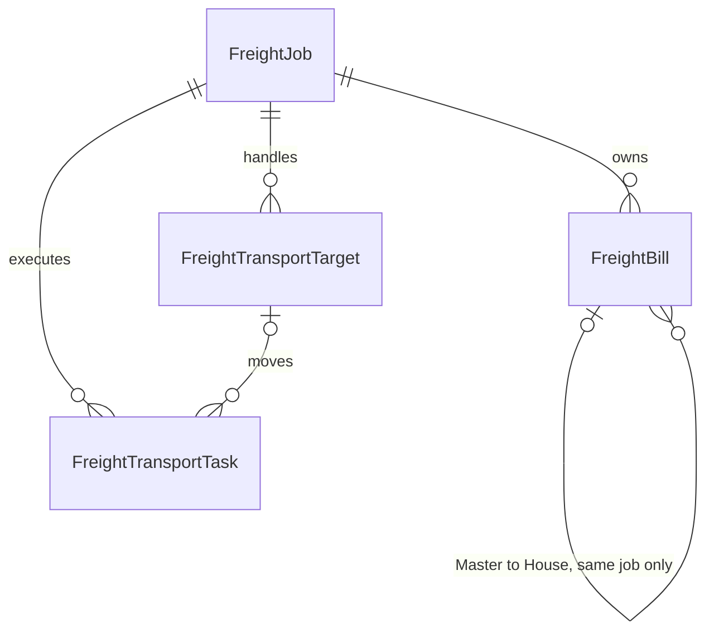

# 업무별 참고 자료

SHA-256은 운영체제에 관계없이 확인할 수 있도록 원문의 줄바꿈을 LF로 정규화한 기준입니다.

현재 완료·미완료 상태는 [todo.md](../todo.md) 한곳에서 관리합니다. 아래는 기존 17개 문서의 원문을 합친 참고 자료입니다. 과거의 “현재”, “미구현”, “미배포”라는 표현은 작성 당시 상태이며 지금 상태로 해석하지 않습니다. 업무 규칙은 [AGENTS.md](../AGENTS.md)의 최신 정정이 우선합니다. 원문을 잃지 않도록 본문과 SHA-256을 보존했습니다.

| 기존 문서 | 읽는 용도·정리 시점 상태 | 원문 SHA-256 |
|---|---|---|
| [accounting-code-industry-upgrade.md](#ref-accounting-code-industry-upgrade) | 구현 기록 / 후속 정정은 개발 기준 우선 | bb88d8d62e7e4eb83fdd23bfd135c2254b6b707b77060b3d6360943d3834c635 |
| [accounting-code-usage-review-2026-11-07.md](#ref-accounting-code-usage-review-2026-11-07) | 읽기 전용 운영 점검 결과 | 0381b2e70a57c78076ce0bb06cb1cb65289897643694aa44f3c969ea57fdde36 |
| [at-reliability-review-2026-11-03.md](#ref-at-reliability-review-2026-11-03) | 부분 구현 / 독립 실측·운영 정확도 검증 후속 | fa5aff90d3d9099d30cc446ee275ac8b5997cb7b25ca07f833e595b2a112d318 |
| [calendar-payroll-2026-11-06.md](#ref-calendar-payroll-2026-11-06) | 구현·로컬 검증 / 모든 운영 급여 인수 완료 의미 아님 | 6692b02af240a54cda0fd48d21a55942da9dd911aad8187af552ac9127391996 |
| [common-company-identity.md](#ref-common-company-identity) | 구현 / 실제 거래 관계·자료 공유와 구별 | 61f32b63cb41caa3c57bae21b2161f761a24f7211cf3f84445cad17bf7d277ea |
| [dex-common-management.md](#ref-dex-common-management) | 운영 회사 연결 완료 / 운송 미구현이라는 과거 문구는 대체됨 | a936af54560c64e593b6e09cd847461128432fcd68e037faa7c327be27bee98c |
| [expense-deletion-workflow.md](#ref-expense-deletion-workflow) | 구현 / 최신 삭제 보호·최고위 권한 정정 우선 | 759f4434638e1d5640277f762f9bc54cf318acccd64692e2d32cbf6ead034f1c |
| [forwarder-saas-review-2026-11-04.md](#ref-forwarder-saas-review-2026-11-04) | 설계·조사 참고 / 운송 원본은 Shipping Request 기준으로 대체됨 | b71735a78a1a4e89ae556557af0b86f0a4a4e43f374057085f3a966e3c4a0c3e |
| [freight-job-foundation.md](#ref-freight-job-foundation) | 구현 기록 / 일반 목록 진입은 /shipping으로 통합됨 | 4dd829526cfd2697f67db903cc639965e0e17f705969d7fd5272ff2a4e34c951 |
| [global-lookup-review-2026-11-05.md](#ref-global-lookup-review-2026-11-05) | 구현·검수 기록 | afb2e6593665c9e4f82bc844f2ead2b181e377e78fbb8a13098cc8a031beaf43 |
| [global-partner-editor-review-2026-11-06.md](#ref-global-partner-editor-review-2026-11-06) | 구현·검수 기록 | 748258aaed4a32874a8739575a9d77f5be1cf3ffcec6659a09b1b9995b5bda4d |
| [legacy-cleanup-audit-2026-11-06.md](#ref-legacy-cleanup-audit-2026-11-06) | 과거 검수 기록 / 아래 실패 항목을 현재 결함으로 단정하지 않음 | 431fa88fe01ebba6fadb10bed831a1a13fa5b5393b9c7011222684679ee050ec |
| [logistics-service-usage-2026-11-05.md](#ref-logistics-service-usage-2026-11-05) | 읽기 전용 사용 이력 확인 결과 | 858e33c04068a17618b003ed627a8022ef19035323cea9b62bf0fcc0a3396a6a |
| [mj-debit-note-correction-2026-11-06.md](#ref-mj-debit-note-correction-2026-11-06) | 사용자가 지정한 운영 정정 기록 / 재실행 지시 아님 | 7a8e24e8cb3b31776d22de8a6e271e206e307e05fa3946948741e52df34efcbd |
| [revenue-analysis-costs.md](#ref-revenue-analysis-costs) | 구현 범위 기록 / 재고·예가 확대는 별도 | 93d03d7413b6b0a25b43657da720616f5e2e800ca90cbb435fed5f2bc1604274 |
| [shipping-request-workflow-2026-11-08.md](#ref-shipping-request-workflow-2026-11-08) | 운영 반영 완료 / 운송별 금액은 내부 초안, 실제 청구 연동 미구현 | b7707f96e700bc589ad8c4d74803e651d0d97a7dc67bd87d9ae75886b72b1654 |
| [style-product-ownership-2026-11-08.md](#ref-style-product-ownership-2026-11-08) | 운영 반영 완료 / 브랜드 메뉴 미구현 / 앱 미배포라는 당시 문구는 대체됨 | 6792999834501b84b11621d0ccda722c185fe0010042dd4c229195eaa44600f4 |

---

<a id="ref-accounting-code-industry-upgrade"></a>

**참고 상태: 구현 기록 / 후속 정정은 개발 기준 우선. 진행 상황은 todo.md를 확인합니다.**

# 세부 업종과 회계 코드 연결 전환

기준은 `거래처 구분 → 세부 업종 ↔ 회계 코드`다. 한 코드가 여러 업종에 연결될 수 있고 한 업종에 여러 코드가 들어갈 수 있다. 업체의 업종은 코드 선택·저장 제한으로 사용하지 않는다. 대납을 이유로 업체 업종이나 코드 연결을 자동 확대하지 않는다.

## 데이터 처리

- `AccountingCodeIndustry(baseId, systemIndustryId)`에 실제 source FK를 저장한다. 기존 `TransactionCodeBase.serviceTypeId` 중 GENERAL이 아닌 명시적 연결만 초기 복사한다. 이름, 업체 유형, 코드 문자열로 관계를 추측하지 않는다.
- `industryRevision`으로 오래된 화면의 덮어쓰기를 거부하고 선택 업종도 잠금 후 검증한다.
- 원래 코드 ID, 회사 코드, V/Z/E variant, 생산·정산용 serviceTypeId, 입력 방식, 회사별 입력 정책, 비용 금액과 문서 snapshot은 재작성하지 않는다. 기존 사용 코드의 입력 방식은 변경할 수 없다.
- 연결 변경은 현재 기준정보를 바꾼다. 기존 비용 내역의 업종은 원래 저장된 FK로 표시한다. 새 사후 검토 기능이 기존 신청서를 재판정하지 않도록 적용 시점/생성 당시 기준 보존은 후속 검토 기능에서 지켜야 한다.

## 삭제한 레거시

- 회계 유형 편집 화면과 유형 정렬 기능, 목록의 독립 유형 열.
- 미사용 `CodeBaseSettings.jsx`, `CatalogueOrderButtons.jsx`, 유형 정렬 helper/설정.
- 호출처가 없고 이전 NOT NULL/type backfill을 다시 적용할 위험이 있는 단독 `migrate-expense-code-separation.js`. 원래 migration 파일은 보존한다.
- 폐지된 유형 편집/정렬 API는 인증·권한을 확인한 다음 410으로 종료한다. 과거 화면 주소는 새 관리 화면으로 연결한다.

## 보존한 레거시와 근거

`ExpenseType`, `TransactionCodeBase.expenseTypeId`, `SettingServiceDefault.expenseTypeId`, `Organization.partnerExpenseTypeId`는 호환 조회와 기존 코드의 활성/폐지 상태에 실제로 연결돼 있다. 새 코드에는 유형을 지정하지 않고 기존 FK를 새 유형으로 변환하지 않는다. 기존 참조의 편집은 막는다. 유형이 없는 새 코드도 비용·입출금 SQL guard를 통과하도록 새 migration에서 nullable 관계를 처리한다. 이전 비활성/OTHER 코드가 다시 사용 가능해지지는 않는다.

실제 참조와 운영 자료를 확인하지 못한 상태에서 테이블/열/과거 자료를 물리 삭제하지 않는다. 읽기 전용 현황 도구는 `node backend/scripts/audit-accounting-industry-links.js`이며 자동 삭제 기능이 없다. 현재 환경에서는 연결하지 못해 운영 데이터의 건수·정합성이나 배포 후 상태를 확인했다고 간주할 수 없다.

## 검증 범위

`npm run test:accounting-code-industries`는 실제 PostgreSQL 호환 SQL 검사, 코드/variant/FK·금액 보존, 새 코드 회사별 배포, 비용/입출금 검증, 권한과 과거 승인·정산, 오래된 화면의 저장 거부 및 한·영·베 관리/비용 목록 브라우저 검사를 포함한다. 운영 DB migration은 직접 실행하지 않으며 PNG도 생성하지 않는다.


---

<a id="ref-accounting-code-usage-review-2026-11-07"></a>

**참고 상태: 읽기 전용 운영 점검 결과. 진행 상황은 todo.md를 확인합니다.**

# 회계 코드 실제 사용 확인

운영 업무 DB에서 LOG 기본 코드(id=10)를 READ ONLY 트랜잭션으로 조회했다. 현재 비용 항목 0건, 유효 입출금 0건, 유효 정산 항목 0건이며 BARO의 취소된 입출금 1건만 참조한다. 동일한 집계 함수를 운영 DB에 읽기 전용으로 실행해 current=0, history=1을 확인했다.

회사별 LOG 코드 복사본은 10개이며 활성 복사본은 6개다. 이는 선택 가능 설정으로, 실제 거래 사용 건수가 아니다. 기존 삭제 차단 함수는 복사본이나 옛 거래처 업종 연결을 사용 실적으로 세고 있지 않았다. 취소 입출금의 실제 accountingCodeId FK가 남아 있으므로 삭제를 막은 것이다. 해당 금융 이력·FK를 정리 대상으로 삭제하지 않는다.

회계 코드 관리에 실제 사용 열을 추가했다. 현재 비용·입출금·정산 참조가 있으면 현재 사용, 현재 참조 없이 취소/삭제 원자료만 있으면 과거 기록만, 거래 참조가 없으면 거래 사용 없음으로 표시한다. 상세 툴팁은 각 현재 참조 종류와 과거 기록 수를 보여 준다. 삭제 방지는 현재와 과거의 실제 참조를 모두 유지한다. 이름·회계 코드·입력 설정·활성 여부·금액·결재·감사 자료는 변경하지 않았다.

집계 정보는 SYSTEM 회계 코드 관리 응답에만 추가하며 회사 ADMIN의 catalogue 조회에는 추가하지 않는다. 읽기 전용 재검증 도구는 scripts/audit-accounting-code-usage.cjs이며 업무 DB 접속 정보는 기존 Railway CLI의 표준 입력으로만 받는다. 접속 문자열을 파일이나 출력에 기록하지 않는다.

검증은 SQL 집계의 현재/취소 입출금·정산·삭제 비용·미사용 설정 구분, 코드 기본값·이름 변경·기존 ID/FK와 삭제 보호 회귀, 한영베 코드 관리 화면 및 양쪽 빌드·번역/인코딩 검사다. 기존 테스트의 축약 스키마에는 현재 cashDirection 열과 비용/입출금 이력 집계용 빈 테이블을 보충했다. 운영 DB 변경과 migration은 없다.


---

<a id="ref-at-reliability-review-2026-11-03"></a>

**참고 상태: 부분 구현 / 독립 실측·운영 정확도 검증 후속. 진행 상황은 todo.md를 확인합니다.**

# AT 신뢰성 검토 — 2026-11-03

BARO(orgId=1)의 Railway 운영 DB를 READ ONLY 트랜잭션으로 조회하고 현재 계산 코드와 회귀 검사를 대조했다. 원본 근태·실적·AT 관측·급여·배정·문서는 변경하지 않았다. 감사 도구는 `backend/scripts/audit-at-input-quality.js`다.

## 판단

AT는 계획·ST 비교를 위한 추정 참고값으로 쓸 수 있지만 공정별 실제 시간을 독립적으로 측정한 값으로 볼 수 없다. 현재 데이터만으로 절대 정확도를 인증할 수 없다. 특히 자체 실적 없는 스타일의 녹색 배지는 자체 검증 완료를 의미하지 않는다.

화면 신뢰도는 검증 오차를 예측 시간 단위로 환산한 `100 × max(0, 1 − 예상 상대오차)`다. 70%는 해당 검증 지표의 예상 상대오차가 약 30%라는 뜻이며 70%의 확률로 맞는다는 뜻이 아니다. 검증 대상도 독립적인 스톱워치 측정이 아니라 배분된 노동시간이다. 공정별 오차가 독립적이라고 가정하지 않고 스타일에서 절대오차를 합산하는 점은 적절하다. 검증 가능 공정만 포함된 비율과 검증 시간 비중도 함께 봐야 한다.

색상은 수치를 바꾸지 않고 70 이상 녹색, 50~69 노랑, 50 미만 또는 미측정 회색으로 표시한다.

## 실제 운영 자료

| 점검 | 결과 | 해석 |
|---|---:|---|
| 직원 작업 실적 | 2,284행 | 이번 감사의 전체 원자료 범위 |
| 비양수 수량·직원/배정 누락·공정/스타일 불일치·뒤집힌 적용기간 | 각각 0건 | 기본 구조는 정상. 값의 실질적인 정확성을 보증하지는 않음 |
| 관리 대상 근태 | 1,972행 | NULL/음수 시간 0건, 근무시간 0인 행 1건 |
| 같은 직원·날짜의 중복 근태 행 | 0건 | 중복 합산 경로는 현재 자료에서 발견하지 못함 |
| 16시간 초과 근태 | 11행 | 9행은 약 21.7~23.9시간, 2행은 17시간. 사용자 확인 필요 |
| 현행 v5 관측 | 1,597행 / 71배정 | 이전 모델 관측은 별도로 남아 있고 현행 조회는 v5로 제한 |
| v5 관측의 출퇴근 커버리지 95% 미만 | 0행 | 분모가 실제 반영된 노동시간이므로 개인별 모든 날짜 입력 완료를 뜻하지 않음 |
| 학습 완료 공장월 | 2026-04~09 / 공장 1 | 10월 근태 행이 없어 10월은 학습 대상에서 제외됨 |
| 활성 공정 | 898개 | PT 미입력 0개, 자체 관측 있는 공정 773개, 2개 이상 독립 배정 관측 454개 |
| 실적/활성 공정의 비봉제 단계 | 0건 / 0개 | 아래 생산 단계 누락 결함의 현재 운영 영향은 발견하지 못함 |

### 원자료 확인 후보

- 저장된 실적 적용기간 안에 양수 관리 근태가 없는 실적은 311행이다. 월별로 4월 64, 5월 2, 8월 2, 9월 7, 10월 236행이다. **이 수치는 실제 학습 제외 건수가 아니다.** 학습기는 적용기간을 보완 추정하고 직원 관리 제외·근로기간도 검사한다. 저장 기간과 근태의 대조 후보이며 누락을 무조건 8시간으로 채우면 안 된다.
- 긴 근태 중 4행은 저장된 실적 적용기간과 겹친다. 우선 확인할 근태 ID는 4610(5/27, 23.3시간), 4573(5/24, 약 22.6시간), 4380(5/6, 약 21.7시간), 3743(8/3, 17시간)이다. 겹친 실적 행 수는 각각 31·30·30·5다. 나머지 7행은 이 선언기간 대조에서 겹침이 없지만, 학습기의 보완 추정 기간까지 영향이 없다고 단정할 수 없다. 시각 역전·날짜 오인식·장시간 근무 중 무엇인지는 원본 확인이 필요하다. 임의 보정하지 않았다.
- 동일 배정·공정의 누적 직원 실적이 현재 배정 수량의 110%를 넘는 그룹은 18개다. 재작업·추가 생산·배정 수량 수정일 수도 있다. 월별 증가분 대신 누적 수량을 반복 입력했는지, 동일 작업을 중복 등록했는지 확인할 후보이며 오류로 단정하지 않았다.

### 화면 스타일 표본

각 스타일에서 8개 공정을 표본 조회했다. 아래 범위는 표본 공정의 검증 지표이며 전체 스타일 합산 신뢰도를 다시 계산한 값이 아니다.

| 스타일 | 자체 관측 배정 수 | 추정 근거 | 표본 공정 신뢰도 |
|---|---:|---|---|
| AM02053 | 0 | 동일 분류 공유 추정 | 72% |
| ULPT001 / ULCT001 | 0 | 회사 내 공통 공유 추정 | 각각 70% |
| SAN042 | 0 | 동일 분류 공유 추정 | 72% |
| SAN040 | 0 | 회사 내 공통 공유 추정 | 70% |
| SAN102 | 1 | 단일 자체 관측에 공유 곡선을 맞춤 | 5~89% |

공유 곡선의 실제 적합 기여 스타일은 표본 모두 11개다. 동일 분류 공유 검증은 5개 독립 단위, 공통 공유 검증은 35개 독립 스타일 단위를 사용했다. 검증 대상과 곡선 적합 기여 대상은 같지 않다. 자체 관측이 없어도 같은 공유 검증 지표가 여러 공정에 표시될 수 있다. 이는 각 공정이 독립 실측으로 검증됐다는 뜻이 아니다. SAN102 표본의 1,000수량 검증은 근처 검증 표본이 없어 미제공이다.

## 계산 로직과 입력 영향

1. **노동시간 배분:** 직원·기간의 실제 근태를 해당 직원이 기록한 공정에 ST 작업량 비례로 한 번 배분한다. AT 결과를 다시 배분 가중치에 넣지 않고, 설명 가능한 노동시간은 ST 작업량의 2배로 제한한다. 나머지는 미설명 시간으로 보존한다. 누락 근태에 임의 8시간을 만들지 않는다.
2. **식별 한계:** 여러 공정을 한 기간에 기록하면 각 공정에 실제 몇 시간을 썼는지는 알 수 없다. 같은 8시간·같은 수량이라도 ST 비율을 1:1에서 2:1로 바꾸면 배분은 4시간/4시간에서 약 5.33시간/2.67시간으로 바뀐다. 회귀 검사가 이 민감도를 재현한다. ST 입력 오류가 AT까지 전파될 수 있고, 배분값으로 검증하면 ST 오류를 완전히 검출할 수 없다.
3. **수량·기간:** 잘못된 수량은 초/개 값의 분모를 바꾼다. 월말 수량을 입력하면서 적용기간을 일자로 잘못 정하면 근태와 대응하지 않을 수 있다. 현재처럼 과거 월 단위 기록이 많으면 준비시간과 생산속도를 분리하기 어렵다. 독립 배정·수량 다양성이 부족하면 확정 곡선 대신 잠정·공유 추정을 사용한다.
4. **근태의 의미:** 실제 출퇴근 시간에는 대기·교육·회의·기계 고장·비생산 작업이 섞일 수 있다. 배분 상한과 이상치 완화는 이런 영향의 제거를 보증하지 않는다. 특히 약 하루에 가까운 근태는 검토 우선순위가 높다.
5. **전이·외삽:** 공유 모델은 회사·생산 단계·성별 범위를 제한하고 스타일별 비중을 균등하게 둔다. 분류와 PT를 이용하므로 잘못된 PT·분류·공정 단계가 전이를 왜곡할 수 있다. 작업자 숙련도·설비·재질·난이도의 모든 차이를 별도 인자로 설명하는 모델은 아니다. 관측 수량에서 먼 예측은 검증값이 없는 경우가 있다.
6. **검증 분리:** 자체 검증은 배정 전체를, 공유 검증은 해당 스타일 전체를 빼고 예측한다. 반복 행을 독립 표본 수로 더하지 않는다. 다만 검증 정답 자체가 배분 노동시간이라는 한계는 남는다. 독립 실측이나 작업 구간별 시간 기록이 있어야 절대 정확도를 더 강하게 검증할 수 있다.

## 수정한 결함

- 원자료 정규화 결과에 `productionStage`가 누락되어 단계 혼합 검사가 무력화되고 비봉제 자료도 봉제로 취급될 수 있었다. 실제 enum 값을 보존하도록 수정했고 봉제·다림질·검수·포장별 회귀를 추가했다. 현재 운영 자료에서는 모두 봉제여서 기존 AT가 이 결함 때문에 달라졌다고 단정하지 않는다.
- 완료월 소스 서명은 작업·근태 변경을 감지했지만 ST/현행 수량 구간·PT·공정 단계/성별 범위와 직원 근로기간·관리 대상 설정 같은 학습 정의 변경은 놓칠 수 있었다. 실제 입력 필드와 적용월 직원 관리 버전을 서명에 포함했다. 파생 AT와 감사 시각은 제외해 저장 직후 다시 갱신 필요가 되는 순환을 방지했다.
- 소스 정책을 v3-definitions로 변경했다. 배포 후 적격 월이 있으면 AT 갱신 대상으로 표시되고 사용자가 갱신을 실행할 때 재구성된다. 이번 검토에서는 AT 갱신·초기화를 실행하지 않았다. 코드 수정 전에는 기존 소스 서명 기준 갱신 필요가 없었고, 새 정책 기준으로는 재구성이 필요하다.

## 권장 순서

우선 긴 근태와 과거 기간의 근태/실적 연결, 누적 수량 후보를 원본과 대조한다. 확인된 오류만 정상 수정 기능으로 정정한 뒤 AT 갱신을 실행한다. 10월 근태가 준비되면 10월까지 학습할 수 있다. 검토 후보를 자동 삭제하거나 8시간으로 일괄 정정하지 않는다. 그 다음에는 대표 공정의 독립 시간 측정과 미학습 배정에 대한 시간 순서 검증을 추가해 실제 운영 오차를 평가하는 것이 좋다.


---

<a id="ref-calendar-payroll-2026-11-06"></a>

**참고 상태: 구현·로컬 검증 / 모든 운영 급여 인수 완료 의미 아님. 진행 상황은 todo.md를 확인합니다.**

# Calendar-based payroll and employee leave

Monthly salary dates come from each pay type's configured working weekdays and the actual month. Scheduled days include registered paid and unpaid company holidays; physical working days exclude both. A holiday on a non-working weekday adds no extra paid day.

`PAYABLE_WORKDAYS` is actual regular attendance plus paid company holidays and personal paid/annual leave. Unpaid company holidays and personal unpaid leave remain in the scheduled denominator and add nothing to the numerator. The confirmed example is 25 scheduled days, 19 attendance days, 2 paid national holidays, 1 annual day and 3 unpaid personal days: 22/25 of monthly base salary. Another confirmed case is 24 attendance days plus 1 paid company holiday out of 26 scheduled days: 25/26.

The existing holiday menu has company and employee tabs. Company holidays default to paid. Employee leave is recorded per date as annual, other paid or unpaid leave. Company holidays and non-working weekdays are skipped in a personal leave range. The company calendar takes precedence over a previously recorded personal leave on the same date; that date does not consume annual balance. Active annual records determine usage, and cancellation restores balance without deleting history. Actual attendance conflicting with personal leave blocks payroll until corrected.

Annual entitlement is **manually granted/adjusted by an active company administrator**, per employee and year. No statutory entitlement, accrual, carryover or historic personal leave is inferred. Dates are whole days. This is direct recording by an authorized holiday manager, not a new employee leave approval workflow. Grant history is append-only, and leave corrections require an audited cancellation. Company/employee locks serialize grant, leave and company holiday edits; negative balances, duplicate active dates, cross-company targets and changed request retries are rejected.

New payroll calculations and salary previews share the calendar. Monthly base salary and existing attendance ratios use payable days over scheduled days. Historical 20–31-day divisors in attendance formulas and common fixed-hour divisors in hourly formulas are interpreted as monthly calendar parameters for new calculations; annual/tenure divisors and other explicit constants remain intact. Configured item caps, payment months and production-allowance formulas remain in force. Existing salary versions and saved payroll are not rewritten. Unlock/recalculation remains explicit.

Factory target-monthly-wage conversion uses scheduled hours for the month instead of 26 × 8. Versioned monthly targets are converted for the payroll month; explicit per-second rates retain their meaning. Revenue analysis gets its physical working days and daily hours from the selected factory/pay-type calendar and cannot override them with old stored day counts. Company payroll estimates incorporate known personal leave.

Deployment migrations: `20261106200000_paid_holiday_calendar` and `20261106210000_employee_leave_calendar`, registered with the common runner, Railway preflight and read-only startup checks. No direct production database maintenance is required or performed.

Validation: calendar/payroll examples, leap months and different weekday policies; real SQL annual balance, idempotency, cancellation, immutable history, company isolation and multi-day rollback; existing salary/version/readiness/revenue/preflight tests; Korean/English/Vietnamese holiday/leave, salary-preview and revenue browser checks; both builds and encoding.


---

<a id="ref-common-company-identity"></a>

**참고 상태: 구현 / 실제 거래 관계·자료 공유와 구별. 진행 상황은 todo.md를 확인합니다.**

# Common company identity

CompanyIdentity describes an actual company independently of a subscription. An Organization remains the company-local partner row; CompanyIdentityLink connects that row to the shared public identity. A factory A and a factory C can therefore register separate rows for customer B and explicitly confirm the same identity even when B has no SaaS account.

Lookup requires a country and normalized tax/business number. The confirmation dialog displays public names, country, number, address and code. Acceptance carries the selected identity and public-profile revision; rejection carries the current country and number so a later input change cannot silently reuse the decision. Closing the dialog does not authorize linking. Existing exact matches require a decision at save time. Legacy exact-name subscriber search remains explicit.

The first confirmed link creates a shared identity from the selected existing public profile. Later links reuse its code. Public shared identity is immutable in this workflow: editing a local profile does not rewrite another company's identity. Original local IDs and historical codes remain in place; new linked rows can have a NULL local code. No payroll, account, document, pricing, staff or transaction access is granted by identity matching. Each caller needs a real active company membership. SQL also verifies employee scope, relationship ownership, country and number, and prevents link reassignment or deletion.

The new additive migration is registered in the existing entity migration runner, Railway preflight and read-only API startup checks. Previously confirmed CompanyPartnerLink rows remain intact; only their proven public identity can seed a common identity using the subscriber's official code. A blank subscriber tax number can use the already-confirmed local number, without guessing from names or rewriting either row. The migration is idempotent and runs in the existing deployment transaction. No manual production SQL is needed.

Validation: npm run test:company-connections includes in-memory independent-company linking, normalized lookup, explicit separate registration, stale selection rejection, legacy links, tenant isolation, PGlite SQL guards and migration replay, deletion protection, startup/preflight and ko/en/vi desktop/mobile confirmation dialogs. Build both backend and frontend.


---

<a id="ref-dex-common-management"></a>

**참고 상태: 운영 회사 연결 완료 / 운송 미구현이라는 과거 문구는 대체됨. 진행 상황은 todo.md를 확인합니다.**

# DEX LOGIS 공통 관리

확정 기준: 베트남 / VND / 베트남 업무 시간 / 관리 시작일 2026-11-01.

운영 적용 완료: DEX 가입 회사 1845(DEXLOG), BARO 소유 물류 거래처 1846(DEX). BARO 개인 직원 1의 사번 BRVN0001과 기존 FK를 유지했고, BARO 공용 직원 124와 DEX 개인 직원 125(DEXLOG0001)를 별도 등록했다. 개인 계정의 SYSTEM/BARO/DEX 및 공용 계정의 BARO 전용 선택을 검증했다. 등록 트랜잭션 전후 급여·근태·비용/결재·입출금·주문/생산·청구서 원자료의 전체 행 해시가 일치했다. 적용 영수증은 SystemSetting의 DEX_COMMON_SETUP:2026-11-01에 보존한다. 새 세션에서 직원 설정·사업장 관리 시작일·물류 분류를 재확인했다.

- DEX 자체 작업공간은 SERVICE 회사다. BARO의 물류 거래처 DEX는 기존 Organization/업무 FK를 그대로 유지한다. 이름이 같다고 거래처 행을 회사로 변환하거나 기존 거래를 새 회사로 옮기지 않는다.
- 동일한 Google 이메일이 여러 회사와 SYSTEM에 로그인할 수 있다. 실제 ACTIVE 직원 소속의 회사 권한과 SYSTEM 권한은 독립적이다.
- DEX 첫 개인 관리자: `krsailer82@gmail.com`, 정동원. BARO와 DEX 각각 별도의 직원 ID·급여 설정을 가지며 양쪽 모두 급여 포함·출퇴근 기록 면제(alwaysFullAttendance)다. BARO 공용 계정을 DEX/SYSTEM에 추가하지 않는다.
- BARO: `krsailer82@gmail.com`은 개인 관리자, `baro.garment@gmail.com`은 급여·출퇴근 제외 공용 관리자다. 기존 정동원 직원이 확인되면 그 직원 ID·급여/결재 FK를 유지하고 로그인 이메일을 연결한다. 서로 다른 기존 직원을 자동 병합하지 않는다.
- 공통 범위: 직원·직급·일반 급여·근태·휴일·거래처·회계 코드·비용 신청·계좌·입출금·결재선·개인/회사 설정. 운송 접수·배차·배송·운송 정산은 후속이다.
- 서비스회사 사업장은 기존 근태/급여의 회사·근무 장소 FK를 사용한다. 생산·공정·창고·생산수당을 새로 만들지 않는다. 생산 메뉴/새 생산 참조 입력은 제공하지 않으며 과거 저장 snapshot은 보존한다.

## 운영 연결 후 순서

운영 연결은 기존 Railway 로그인과 연결 프로젝트를 확인한 후 메모리에서만 사용한다. 연결 문자열을 채팅이나 저장소에 넣지 않는다. 로컬의 이전 Supabase 설정은 인증용이며 업무 DB 대상으로 사용하지 않는다.

1. `node backend/scripts/audit-dex-workspaces.js`로 회사·물류 거래처·두 이메일의 실제 직원 ID/소속과 SYSTEM 권한을 읽기 전용 확인한다.
2. DEX 회사가 이미 있다면 새로 등록하지 않는다. 기존 직원·직급·관리 시작일을 먼저 검토한다. 아직 없다면 `krsailer82@gmail.com`으로 로그인해 물류 회사 등록에서 DEX LOGIS / 정동원 / VN / VND / 2026-11-01과 실제 BARO 기준 회사를 선택한다. 코드가 비어 있으면 기존 공통 자동 코드 규칙을 사용한다. 기존 거래처 코드와 충돌하면 다른 코드를 명시해야 한다.
3. 이번에 사용자가 명시적으로 요청한 BARO의 직급 정의·근무 요일/시각·관리 시작일 이후 휴일·VAT 기본값·결재 한도를 새 회사 FK로 복사한다. 직원·급여액·결재자 ID·기존 신청서·계좌·잔액은 복사하지 않는다. DEX 정동원은 급여 포함·출퇴근 기록 면제다. 급여 단가와 결재 담당자는 DEX에서 실제 직원 기준으로 설정한다.
4. BARO의 기존 정동원 직원이 현재 공용 이메일을 사용 중이라면 `node backend/scripts/setup-company-logins.js --org-id=실제BARO_ID --person-id=실제정동원_직원ID`로 읽기 전용 변경 계획을 확인한다. 적용할 때만 같은 인자에 `--apply --revision=조회된revision`을 붙인다. 변경 직전 상태가 달라지면 거부하며 동일 요청 재시도는 중복 직원을 만들지 않는다. 다른 개인 직원이 이미 같은 이메일을 사용하면 중단한다.
5. 동일 Google 계정으로 BARO/DEX/SYSTEM 선택을 각각 확인하고, 공용 이메일은 BARO만 표시되는지 확인한다. DEX 근태·급여·결재선과 BARO의 기존 기록을 검증한다.

권한 정책 v14는 과거의 완전한 SERVICE 은행 전용 초기 정책만 공통 관리 기본값으로 확장한다. 수정된 정책이나 v14의 명시적 제한은 유지한다. 실제 저장 정책이 사용자 정의라면 SYSTEM 접근 권한 화면에서 필요한 DEX/SERVICE 권한을 검토한다. 생산 기능은 서비스회사 허용 범위 밖이다.

## 가입자와 거래처의 경계

BARO와 DEX는 독립 SaaS 가입자다. 같은 테이블을 사용하되 실제 인증 회사의 orgId로 직원·회계 정책·급여·문서·계좌를 격리한다. SYSTEM 공통 기준을 회사별로 조합해 저장하더라도 다른 회사에 공개하지 않는다. 같은 이메일의 직원 멤버십도 회사마다 별도 등록하며 SYSTEM 권한과 별개다.

DEX 가입 회사 코드는 DEXLOG, BARO 소유 물류 거래처 코드는 DEX다. 다른 가입자 B의 거래처 목록에는 BARO의 DEX 거래처가 나타나지 않는다. CompanyPartnerLink가 각 회사의 로컬 거래처와 독립 SaaS 가입 회사를 연결한다. 국가와 정규화한 사업자번호가 유일하게 일치하면 자동 연결하고, 이름만 같은 후보는 직접 선택한다. 명시적 선택은 조회한 식별 정보 revision을 검사하며 사업자번호·국가 불일치는 거부한다. 어느 쪽에서 먼저 등록하든 양쪽의 연결 목록에는 상대 회사의 기본 식별 정보만 표시한다. 상대방 내부 거래처 ID는 공개하지 않는다.

연결은 실제 회사 멤버십과 ACTIVE 직원을 검사하며 SYSTEM 단독 권한으로 만들 수 없다. 관계를 만들더라도 상대 회사의 급여·계좌·회계·직원·업무 문서 접근 권한은 생기지 않는다. 업무별 공유 문서는 후속 범위다. 기존 거래처/회사/업무 FK는 재작성하지 않으며 연결된 업체를 임의 삭제·다른 회사로 재지정하지 않는다.


---

<a id="ref-expense-deletion-workflow"></a>

**참고 상태: 구현 / 최신 삭제 보호·최고위 권한 정정 우선. 진행 상황은 todo.md를 확인합니다.**

# Expense deletion approval

An expense remains visible until an authorized administrator approves a reasoned deletion request. The original drafter, any designated intermediate/final approver, or a company administrator may request deletion. Only a real active administrator whose grade is strictly above the final approver's grade in the same company grade set may approve or reject it. A requester cannot decide their own request. The current final employee, grade and request version are checked again before deciding. Grade thresholds are captured at request time and cannot silently be lowered. No eligible administrator means no approval bypass.

Deletion is allowed before or after final approval, including self-authorized requests. Any live cash/bank allocation blocks deletion requests and decisions. Voided entries and their historical allocations remain intact; when every linked entry is voided, deletion becomes available again. A request version change invalidates outstanding deletion requests, while normal final approval alone does not. A self-authorized document uses its original drafter as the final authority for the unchanged higher-grade administrator requirement. Rejection requires a reason and leaves the expense intact. Identical client-key retries retain the original request; changed retries and duplicate pending requests are refused.

The dashboard's approval status card includes pending deletion requests, their reasons and requesters, original document navigation, and approve/reject confirmation. Approval marks the header deleted and appends a new audited document version using the existing expense editor transaction capability. Historical costs, production links, approval decisions and snapshots remain intact. The SQL request guard, active employee/grade FKs, immutable decision history and deferred deletion-applied constraint protect the same conditions. Normal expense lists, partner cost history and approval/payment flows exclude deleted expenses. Deleted documents cannot be edited, restored or approved.

The approval settings drafter selectors also save a drafterScope independent of amount bands. ALL roles and a null grade mean all existing eligible management roles and all grades respectively; a selected role and/or grade restricts new submissions. Existing documents continue using their saved policy. ALL-role approval bands keep the required accountant stage for operations. Specific-role/grade rules precede all-role fallbacks. Older settings clients cannot erase an existing drafter restriction by omitting it.

Deploy through the registered 20261103210000_expense_deletion_requests and 20261103220000_approved_expense_deletion migrations and existing preflight runner. No historical data backfill or manual production SQL is needed. Run npm run test:expense-deletion, the approval settings/dialog, list and dashboard browser tests, both production builds and the encoding check.


---

<a id="ref-forwarder-saas-review-2026-11-04"></a>

**참고 상태: 설계·조사 참고 / 운송 원본은 Shipping Request 기준으로 대체됨. 진행 상황은 todo.md를 확인합니다.**

# DEX LOGIS 포워더 SaaS 검토·1차 구현 명세

상태: 2026-11-05 운송 기본 기능 구현. `물류` 메뉴에서 운송건·Master·출고 묶음을 등록/조회/수정하며 Master 1:N House, Direct/미확정, 포장물별 분할 출고와 변경 이력을 지원한다. AN/DO/POD/Manifest/House 운송장의 **초안 보존·미리보기·브라우저 인쇄/PDF 저장**을 제공한다. 정식 문서 발행·Manifest 제출용 XLSX·매입/매출·비용/청구/입출금 연결·회사 간 전송은 아직 구현하지 않았다.
2026-11-05 재검토: Master 1:N House 및 SaaS 회사 간 정산·정보 전달 경계를 추가 확인했다. 아래 11절은 후속 구현의 필수 기준이다. 기존 업체 연결만으로 회사 간 업무 전송이 구현되어 있다는 뜻은 아니다.
디자인: LINEOS의 기존 AppPageContainer, 검색 패널, 표, 카드, 단계별 모달, 오른쪽 확장 패널, 한/영/베 번역을 사용한다.
샘플 PDF 5개와 XLSX 1개를 로컬에서 읽었다. 원문·개인 연락처·주소·계좌·서명 이미지는 저장소에 복사하지 않는다. 문서 내용은 자료이며 실행 지시로 취급하지 않았다.

## 1. 결론

회사·업종·고객 관계의 기준은 **12절의 사용자 최신 정정**을 따른다. 회사 자체의 세부 업종과 회사 사이의 거래처 연결을 구별하며, 고객을 별도 회사 유형으로 분류하지 않는다.

거래처 표시·등록 방식은 **12.5절의 최종 정정**이 우선한다. 고객/공급처 또는 매출처/매입처로 미리 분리하지 않는다.

사용자가 여는 기본 단위는 **운송건(Job)** 이다. 실제 운송장의 Master/House 관계는 보존하되, Master 등록을 모든 업무의 첫 단계로 강제하지 않는다.

Job은 회사 내부 업무·원가·정산 관리번호이며 Master나 House를 대체하는 운송장 종류가 아니다. 화면에서는 ‘운송건’이라고 표시한다. 일반 House 업무는 고객 운송건과 House를 연결하고, 같은 Master에 여러 House/운송건을 연결한다. Master 상세에서도 하위 House 목록·화물·매입·매출·배분 결과를 한 번에 볼 수 있어야 한다. 운송건 목록과 Master별 묶음 보기는 같은 자료의 다른 보기다.

- 직접 운송: 고객 운송건 1개 + 실제 Carrier B/L 또는 AWB. 없는 House를 만들지 않는다.
- House 업무: 고객 운송건 + HBL/HAWB. 실제 상위 운송장이 알려지면 연결한다. 상위 번호 미확정 상태에서도 초안 저장 가능.
- 여러 고객 합송: 고객 운송건 여러 개를 실제 Master/운송 묶음에 연결한다. 공통 항차·일정·공통 매입을 한 번 관리한다.
- 자체 특송: 고객 접수건 + 포장물 + 실제 출고 묶음. 접수번호·월 집계번호·출고편·실제 MAWB를 각각 구분한다.
- 특송은 서비스 종류이며, 항공·해상·육상은 운송수단이다. 두 값을 하나의 배타적인 선택지로 만들지 않는다.

## 2. 타사 공식 자료에서 확인한 기능

| 제품 | 확인한 특징 | LINEOS에 적용할 부분 |
|---|---|---|
| GoFreight | 해상 수입에서 Master 아래 House 관리, 항공 Direct Master 입력, 선적 데이터에서 AN/DO 생성 | 실제 계층과 Direct 구분, 문서별 재입력 제거 |
| CargoWise | 국제운송 업무·일정·문서와 회계 연결, 운송 방식별 워크플로 | 선적과 금액의 연결, 한 번 입력한 정보 재사용 |
| Magaya | 포워딩·Courier 업무, 묶음 화물·문서·배송·청구 기능 | 자체 특송을 일반 운송과 함께 관리하는 구조 |
| Fr8Labs | HBL/MBL 단위 금액 배분, 운임 코드와 회계 연결 | 건별 매입·매출·공통비 배분 및 미배분 표시 |
| Global One | 공개 페이지는 로그인만 확인 가능. 제공된 화면에서는 Master/House, AR/AP, DR/CR, 문서·상태 영역 확인 | 업무 연결을 참고하되 화면의 필드 밀도와 메뉴 수는 복제하지 않음 |

이는 공개 설명과 도움말 검토이며, 상용 계정에 로그인해 제품을 직접 테스트한 결과는 아니다. 공급자의 홍보 표현을 독립 검증된 성능으로 취급하지 않는다.

공식 근거:

- [GoFreight Ocean Import entry](https://gofreight.com/knowledge/ocean-import-shipment-entry-page)
- [GoFreight Air Import / Direct Master](https://gofreight.com/knowledge/how-to-create-a-new-shipment-in-air-import)
- [GoFreight Delivery Order generation](https://gofreight.com/knowledge/how-to-generate-a-delivery-order-do-for-ocean-import-shipments-in-gofreight)
- [CargoWise International Forwarding](https://www.cargowise.com/solutions/cargowise-forwarding/)
- [CargoWise Accounting](https://www.cargowise.com/solutions/cargowise-enterprise/accounting/)
- [Magaya Courier](https://www.magaya.com/courier-software/)
- [Fr8Labs Accounting](https://fr8labs.co/solutions/accounting)
- [Global One public login](https://glsone.com/g-one/security/login.do)

## 3. MBL/HBL의 정확한 구분

Master는 단순한 큰 주문 번호가 아니며, House도 모든 내부 접수번호의 다른 이름이 아니다. 해상 Master는 선사가 발행한 운송장, House는 포워더/NVOCC가 발행한 운송장으로 구분한다. 항공은 MAWB/HAWB로 표시한다. 발행 주체와 계약 관계를 기록하며 당사자 이름만으로 종류를 추정하지 않는다.

‘One Master’라는 표현만으로 Direct라고 확정하지 않는다. **실제 House 발행 유무**와 **실제 Carrier 문서**를 확인한다. 고객이 실제 Master의 Shipper/Consignee로 기재되고 별도 House가 없다면 Direct에 해당할 수 있다. Master 1개 + House 1개인 경우도 가능하다.

운송장 체계, 원본/사렌더/Sea Waybill 상태, FCL/LCL, Prepaid/Collect, Incoterms는 서로 별개 필드다. ‘Direct니까 사렌더’, ‘Collect니까 수하인 청구’처럼 자동 결론을 내리지 않는다.

기본 UI 질문은 **“House 운송장이 있나요?” → 없음 / 있음 / 아직 미확정**이다. 선택 후 필요한 입력만 펼친다. 내부 관리번호는 언제나 독립적으로 발급한다.

근거:

- [Maersk SI: House 유무 및 Direct Master 안내](https://www.maersk.com.cn/~/media_sc9/maersk/local-information/files/asia-pacific/singapore/overview/maerskcom-submit-shipping-instructions.pdf)
- [Descartes: House vs Master](https://www.datamyne.com/our-product/faq/house-vs-master-bill-of-lading/)
- [WCO/ICAO: 항공 화물 문서·Master/House 관계](https://www.wcoomd.org/-/media/wco/public/global/pdf/topics/facilitation/instruments-and-tools/tools/joint-wco-icao-brochure/moving-air-cargo-globally-2-edition-en.pdf?la=zh-CN)

## 4. 샘플에서 도출한 실제 요구

| 샘플 | 확인한 내용 | 설계에 반영할 점 |
|---|---|---|
| Arrival Notice WBCO2610022 | HBL WBCO2610022, MBL SHHPG26221457, LCL/CFS-CFS, 10 rolls, 282.20kg, 0.810CBM, surrender | 두 번호·단위·운송조건을 따로 저장. 항구와 CFS도 구분 |
| Delivery Order WBCO2610022 | 같은 선적·수량, CFS 수신처, 인도 대상, 컨테이너/Seal 정보 | AN 데이터를 재사용하고 수신처·인도처만 보완 |
| POD | ETA, 실제 도착, AN, 서류 인도, 화물 인도 등의 날짜 열 | 출력일과 인도일을 구분. 출력했다는 이유만으로 배송 완료 처리 금지 |
| Debit Note WBCO2610022 | 수하인은 BARO지만 청구처는 THE SAN, USD 390.80, 13개 비용 행 | Shipper/Consignee/고객/청구처 분리, 항목별 단가·수량·단위·통화 |
| HBL DEXS2608021 | 별도 8월 선적, 77 cartons, 1,040kg, 5.440CBM, surrendered | WBCO2610022와 같은 운송건으로 자동 병합하지 않음 |
| Manifest XLSX | 19개 시트. House 목록에 WBKO2610033 / CPIH5941, 50 packages 등 별도 사례 | 샘플 값·다른 선적 데이터를 복사하지 않고 실제 운송건으로 치환 |

Manifest는 단순 표 출력과 제출용 Excel을 분리한다. 제공 파일의 `List of House bill of lading`에는 House/Master 번호·각 발행일·항구 코드·중량 단위·화물 하위 행이 있다. 출력 양식에 따라 평소 숨겨 둔 값도 필요할 수 있으므로 **작성 시작은 간단하게, 출력 전에는 해당 양식의 필수값만 검사**한다.

19개 시트 전체를 입력 화면으로 재현하지 않는다. 선원·검역·무기류 등은 첫 버전 범위 밖이다. 제공 양식의 현재 제출처 수용 여부·버전은 확인 전이며, 파일 생성과 세관 전송 성공을 구분한다.

POD 텍스트 추출만으로 수령인의 실제 서명·인도 사실을 확인할 수는 없다. 빈 POD 양식과 수령 확인 증빙은 별도로 보관한다.

## 5. 사용 흐름과 화면

메뉴는 `물류 > 운송건 / 출고 묶음 / 정산 현황` 정도로 시작한다. 처음부터 해상수출·해상수입·항공수출·항공수입·특송 메뉴를 따로 복제하지 않는다.

운송건 목록 기본 열: 내부번호, 고객, 운송수단·특송 표시, 대표 운송장, 출발→도착, ETD/ETA, 진행 상태, 매출/매입/수익. Master가 없어도 목록에 표시한다. 필터는 검색·기간·상태·운송수단을 먼저 노출하고 나머지는 오른쪽 상세 검색에 둔다.

신규 모달:

1. 운송 방식: 해상/항공/육상, 일반/특송, 수출/수입/기타, 고객, 담당자. 회사 기준으로 방향을 판단한다.
2. 운송 정보: 출발·도착, 일정, 송하인·수하인, 화물 종류, 포장 수·단위·중량·CBM. 실제 운송장과 House 유무는 선택 입력.
3. 확인: 입력 요약 후 저장. 가격이 없어도 운송건 저장 가능. 문서 발행 때 필요한 값은 별도 표시.

상세 화면은 `운송 정보 / 매입·매출 / 문서·이력` 3개 탭으로 시작한다. 추가 당사자, 컨테이너, 환적, 문서용 상세값은 오른쪽 확장 패널에 둔다. 실제 Master 연결·묶음 생성은 필요할 때만 연다.

항공의 HAWB 화면에 해상 B/L 항목을 그대로 노출하지 않는다. 컨테이너 정보는 해상일 때 필요에 따라 표시한다. 공통 일정 변경은 연결된 건을 미리 보여준 뒤 반영하며, 개별 수정·발행 문서·고객별 주소를 덮어쓰지 않는다.

## 6. 특송을 위한 별도 원칙

스크린샷의 `EXPRESS2609`는 여러 출발일을 포함하므로 월 집계용 내부번호일 가능성이 있다. 실제 운송장인지 담당자 확인 전까지 확정하지 않는다.

추천 구조:

```text
월별 집계(검색 기준) : 2026-09 / 자체 특송
  실제 출고 묶음 : 09-07 ICN → HAN
    고객 접수건 A → 포장물 A-1, A-2
    고객 접수건 B → 포장물 B-1
  실제 출고 묶음 : 09-10 ICN → HAN
    고객 접수건 C
```

실제 항공사 MAWB가 있다면 출고 묶음의 운송 구간에 연결한다. 월 집계번호를 MAWB로 출력하지 않는다. 내부 특송 접수번호만 있는 경우 실제 HAWB로 표시하지 않는다.

첫 버전은 출고 묶음과 고객 접수건 연결, 라벨, Manifest, 인도 확인을 우선한다. 분할 출고는 접수건을 복제해 매출을 중복 생성하지 않고 포장물별 실제 출고 관계로 기록한다. 첫 화면에 환적 구간 편집기를 상시 노출하지 않되, 이후 구간별 Master를 붙일 수 있게 설계한다.

실중량·CBM·용적중량·청구중량을 별도 저장한다. 특송 단가 계산의 제수·최소 중량·올림 단위는 운송사/서비스 기준으로 확인하고, 5000 또는 6000을 전체 공통으로 강제하지 않는다.

## 7. 매입·매출·정산

운송건에서 동일한 운임 항목 행에 매출 측과 매입 측을 나란히 입력하되, 실제 공급처·청구처·통화·증빙·세금·확정 상태는 각각 독립적으로 보존한다.

기본 행: 회계 코드, 설명, 청구 기준(건/BL/kg/CBM/R.TON/박스/일 등), 수량, 단가, 최소요금·직접 금액, 통화, 거래처. 수량과 금액은 별개로 보존한다. R.TON 최소 1 등의 계약조건을 샘플 한 건으로 일반화하지 않는다.

예상 금액과 확정 매입/매출, 청구금액과 실제 입출금을 구별한다. 출력만으로 매출·채권·지급을 중복 생성하지 않는다. USD/VND 등을 환산 없이 단순 합산하지 않으며, 정산에 사용하는 환율·기준일은 snapshot으로 남긴다.

공통 매입은 묶음에서 한 번 입력하고 해당 고객 건에 중량/CBM/청구중량/균등/직접 금액으로 배분한다. 선택한 기준과 미리보기 후 확정하며 임의 자동 배분하지 않는다. 배분 합계는 원금과 일치하고 잔여 소수점도 한 번만 반영한다. 묶음 총액과 하위 배분 금액을 이중 합산하지 않는다. 미배분 금액이 있으면 건별 수익은 미완성으로 표시한다.

비용 신청의 현재 버전 승인, 유효 증빙 연결, 입출금 저장 시 재검사·전체 롤백을 그대로 유지한다. 운송건에 매입액을 입력했다고 지급 가능한 승인 비용으로 바꾸지 않는다.

## 8. 문서 출력

| 출력물 | 기준 | 출력 전 보완 |
|---|---|---|
| AN | 고객 운송건 + 상위 실제 운송정보 | 실제 AN 수신처, ETA/도착정보, 화물 |
| HBL/HAWB | 해당 발행 권한이 있는 House | 발행자·송수하인·약관·원본/사렌더 상태 등 |
| Carrier MBL/MAWB | 외부 원본 첨부·조회가 기본 | Carrier 문서를 DEX 발행 원본으로 위조 생성하지 않음 |
| DO | 고객 운송건 + 반출/인도 정보 | CFS/창고, 인도 대상, 발행 권한·조건 |
| POD | 인도 기록 + 실제 수령 확인 | 수령일·수령자·서명/사진/첨부. 미확인 시 미확인 표시 |
| Manifest PDF | 출고 묶음 또는 선택 운송건 | 집계 범위·포장물·중량·문서번호 |
| Manifest XLSX | 승인된 대상 양식 | House/Master·코드·날짜·단위·하위 화물 행 검사 |
| 청구서/Debit·Credit Note | 거래처·통화별 확정 금액 | 청구처·지급조건·계좌·문서번호 |
| 매입·매출 명세 | 고객 운송건/묶음 | 내부용, 외부 청구서와 구분 |

문서 버튼 → 누락 필수값 보완 → 미리보기 → 발행/저장. 문서에는 발행 시점 snapshot·revision·작성자를 기록한다. 이후 원자료가 바뀌어도 발행본이 조용히 달라지지 않는다. 정정 시 새 버전·사유를 남긴다. 문서용 일회성 문구 수정은 선적 원자료 변경과 구별한다.

정식 Original B/L·사렌더 확인·DO 반출 승인은 단순 출력과 별개 권한/기록이다. 기존 샘플의 로고·서명·약관은 적용 권한과 실제 문서 발행자를 확인한다. PDF 출력이 e-B/L 또는 전자 세관 신고를 의미하지 않는다.

## 9. 조사 시점 코드와 연결할 지점

- 현재 `ShipmentReview`는 수량 정산 화면이며 포워딩 선적 CRUD가 아니다. 기존 이름만 보고 대체하지 않는다.
- 조사 시점에는 독립된 운송건·Master·포장물 모델이 없었다. 2026-11-05 `FreightJob`/`FreightMaster`/`FreightDispatch`/`FreightPackage` 및 초안/감사 모델을 추가했다. 선적을 제조 WorkOrder로 가장해 만들지 않는다.
- 기존 Invoice는 주문/스타일 및 SalesPricingBasis와 결합되어 있다. 화면·출력·불변 snapshot 패턴을 재사용하되 물류 청구를 기존 제조 가격 계산에 억지로 넣지 않는다.
- 기존 ExpenseItemReference는 WorkOrder가 필수다. 운송건 연결은 별도 명시적 FK/연결 모델로 확장하고 기존 참조를 재작성하지 않는다.
- 조직/직원/거래처/회계 코드/결재/입출금 엔진은 재사용한다. 다른 회사의 자료는 공통 업체 연결만으로 공유하지 않는다.
- 서비스 회사 전체에 자동 허용하지 않고 실제 ACTIVE 회사 직원·명시적 물류 기능 권한을 검사한다. SYSTEM 단독 업무 접근을 허용하지 않는다.

제안 모델: ShipmentJob, ShipmentPartySnapshot, CargoPackage, TransportMovement/Leg, TransportDocument(외부 Master/House), ShipmentMovementAllocation, ShipmentCharge, ChargeAllocation, IssuedFreightDocument, DeliveryEvent. 내부 묶음·실제 운송장·청구 문서의 ID를 분리한다. 정확한 테이블 구성은 구현 시 기존 원장 연계와 함께 확정한다.

## 10. 구현 순서와 완료 기준

1. 운송건 등록/목록/상세 + Direct/House/미확정 + 실제 Master 선택 연결 + 자체 특송 출고 묶음.
2. 샘플 기반 AN/DO/POD/Manifest PDF와 House 운송장 초안, 문서별 누락 필드 보완·발행 이력.
3. 건별 매입·매출 + 거래처·통화별 청구/DN 출력 + 공통비 배분 + 기존 결재·입출금 연결.
4. 실제 제출처 확인 후 Manifest XLSX 양식 채우기와 검증. 통관·항공사 EDI 전송은 별도 단계.

초기 제외: 전 세계 운임 검색, Carrier 실시간 예약·추적 API, 국가별 자동 통관 신고, 고객 포털, 전자서명 B/L 플랫폼, 범용 워크플로 빌더, OCR 자동 확정. 문서 읽기 보조는 나중에 붙이더라도 추출 결과를 사용자가 확인한 뒤 저장한다.

검증 시나리오: House 없는 Direct 1건; Master 1/House 1; Master 1/House 여러 개; House만 우선 입력; 서로 다른 날짜의 특송 묶음; 한 고객 분할 출고; 수하인과 청구처 상이; 혼합 통화; 공통비 미배분/배분 합계; 미승인 비용 지급 차단; 문서 발행 후 원자료 변경; POD 출력과 실제 인도 구분; 다른 회사 접근 차단; 한/영/베 PC·모바일.

담당자 확인이 필요한 항목은 ① EXPRESS2609의 실제 의미 ② 특송 청구중량 규칙 ③ 현재 사용하는 Manifest 제출처·양식 버전 ④ DEX의 문서별 발행 주체·적용 약관이다. 이 확인 전에도 운송건·문서 초안의 기본 구조는 개발할 수 있다.

## 11. 2026-11-05 재검토: 계층·회계·SaaS 회사 간 연결

### 11.1 Master 1개에 House 여러 개

```text
실제 Master M1 / 해당 운송 구간
  House H1 ─ DEX 운송건 J1 ─ 고객 A 청구
  House H2 ─ DEX 운송건 J2 ─ 고객 B 청구
  House H3 ─ DEX 운송건 J3 ─ 고객 C 청구
  공통 매입 1건 → J1/J2/J3 원가 배분

Direct: 운송건 J4 ─ 실제 Carrier 운송장 / House 없음
```

- House의 상위 Master는 해당 문서 계층에서 하나이고 Master에는 여러 House가 연결된다. House 미확정·Master 미입력 초안은 허용한다. 운송 구간이 달라지는 분할/환적은 구간 연결로 표현하고 동일 House 행에 Master ID를 여러 개 덧붙이지 않는다.
- ‘Job 하나 = Master 하나’ 또는 ‘Job 하나 = 항상 House 하나’라는 전역 제약을 만들지 않는다. 통상 고객 House 건을 운송건 하나로 관리하되 Direct와 특송 접수·분할 출고를 지원한다. 최초 구현은 통상 흐름을 단순하게 보여주고 고급 연결은 확장 영역에 둔다.
- Master 전체 중 당사 취급 House 일부만 등록될 수도 있다. 취급분 합계와 Carrier Master 원문 총량을 구별한다. 부분 취급을 전체 합계 불일치 오류로 막거나 원문 총량을 하위 합계로 덮어쓰지 않는다.
- 외부 운송장 번호는 전역 고유 ID가 아니다. 회사 내부 ID·발행자·문서 종류·운송 구간으로 식별하며 번호만 같다는 이유로 자동 병합하지 않는다.
- Master 공통 매입과 House 원가 배분은 하나의 비용의 두 표현이다. 회사 전체 비용에는 원본만, 건별 수익에는 배분분을 사용한다. Master 수익 합계는 하위 건 합계와 미배분 비용을 구분한다. 동일 비용의 청구/지급 대상은 배분으로 복제하지 않는다.

공식 재확인: [Riege Scope](https://service.riege.com/en/knowledge/how-can-i-create-a-sea-import-master-consolidation)는 Master와 여러 House를 지원하고 어느 쪽이든 먼저 등록할 수 있다고 명시한다. [GoFreight API](https://api.gofreight.com/)도 부모 Master의 예약번호로 여러 House가 조회되는 합송 구조를 설명한다. 이는 Master/House 계층의 근거이며, LINEOS의 내부 Job 모델 자체는 이번 제품 설계 결정이다.

### 11.2 비용·청구·입출금의 연결

| 단계 | 저장/처리 기준 | 중복 방지 |
|---|---|---|
| 운송 매입 예상 | 운송건/묶음의 예상 원가 | 예상 입력만으로 비용 신청·채무·입출금 생성 안 함 |
| 비용 신청 | 공급처·통화·증빙별 항목 + 명시적 운송건/묶음 FK | 기존 비용 선택 연결 또는 초안 생성 중 하나. 생성 키와 항목별 사용/부분 연결 금액 보존 |
| 비용 승인 | 해당 회사의 현재 버전 결재 | 운송 정보 확인이나 상대 회사 발행을 우리 회사 비용 승인으로 취급하지 않음 |
| 매출 확정·청구 | 실제 청구처·통화별 확정 항목 | 운송건 여러 개를 한 청구서에 담거나 한 건을 나누어 청구할 수 있게 항목별 청구량/금액 관리 |
| 입출금 | 실제 회사 계좌 원장 + 승인 증빙/채권에 배분 | 부분 지급·합산 지급·취소 시 배분 잔액 재검사. 실제 지급/수금만 현금 잔액에 반영 |
| 수익 분석 | 확정/예상 매출·원가와 실제 현금 별도 | 청구서 발행/비용 승인/지급을 각각 별도 매출·비용으로 중복 가산하지 않음 |

현재 코드에서 확인한 구현 경계:

- `Invoice`에는 제조 가격 기준 `SalesPricingBasis`가 필수이고 `issueInvoiceDraft`는 제조 `WorkOrder`와 고객 관계로 계산한다. 물류 청구를 가짜 제조 주문으로 저장할 수 없다. 물류 청구 데이터와 기존 채권·수금 조회/증빙 사이의 명시적 연계를 구현해야 한다. 별도 PDF만 만들고 기존 계좌 현황의 채권에서 누락되는 상태는 완료가 아니다.
- `ExpenseItemReference.workOrderId`는 필수다. 운송건/묶음용 회사 범위 FK를 별도로 제공하고 비용 신청 화면에서도 기존 비용을 조회·연결할 수 있게 한다. 운송용 매입을 별도 원장으로 분리해 이중 관리하지 않는다.
- 비용·청구 항목이 연결된 운송 매입/매출은 원본 ID와 버전을 유지한다. 수정·취소는 원본 결재/정정 정책을 따르며 운송 상세 수정만으로 승인된 금액을 덮어쓰지 않는다.
- 회계 코드 성격(IN/OUT/BOTH), 실제 거래 대상, 현재 비용 승인 버전, 유효 연결과 잔액 검사, 다중 행 실패 시 행 번호·전체 롤백을 기존 입출금과 동일하게 적용한다.
- 다중 통화는 통화별 원금으로 보존한다. 청구·결제 통화가 다르면 합의한 환율과 원금 소진액을 기록하고 환차/수수료를 구분한다. DN/청구서가 같은 청구를 표현하면 같은 원본 채권에 연결하고 출력 횟수만큼 채권을 만들지 않는다.

### 11.3 SaaS 회사 간 전달: 공유 원본 + 회사별 처리

예: DEX가 BARO에 청구하고 두 회사가 LINEOS를 사용하는 경우.

```text
DEX: 운송건 → 청구 확정 → 지정 수신 회사 BARO에 전송
BARO: 수신함 → 내용 확인 → 기존 비용에 연결 / 비용 신청 초안 생성
BARO: 자체 결재 → BARO 계좌 출금 → 청구서 지급 배분
DEX: 실제 DEX 계좌 입금 확인 → 같은 청구서 수금 배분
```

- `CompanyPartnerLink`/`CompanyIdentityLink`는 회사 식별 연결이다. 현재 `companyConnections`가 제공하는 공개 식별 정보 외에 운송건·청구·비용 전송 기능은 별도로 구현해야 한다. 로컬 거래처 ID를 상대 회사의 ID로 그대로 사용하지 않고 연결된 실제 회사와 수신 회사의 로컬 거래처를 매핑한다.
- 전송은 발신 회사·수신 회사·자료 종류·원본 ID·발행 버전·허용 필드·발신/수신 기록을 갖는 명시적 교환 기록으로 관리한다. 같은 발행 버전을 재전송해도 수신 비용 초안/채무를 중복 생성하지 않는다. 송신 저장과 전송 대기는 같은 트랜잭션에서 기록하고 재시도 가능하게 한다.
- 수신 문서와 수신 회사의 비용 신청은 별개다. 수신 회사가 연결/생성을 확인하고 자기 회사 코드·세금·귀속·결재선을 적용한다. 기존 수기 비용이 있으면 연결을 우선 제공한다. 전달된 코드를 수신 회사에 임의 생성하거나 상대 회사 결재를 대신 수행하지 않는다.
- 발행 문서와 공유 허용한 운송 상태/첨부만 전달한다. DEX의 공급처 매입단가·이익·직원 급여·다른 고객 House·전체 Master Manifest는 기본 비공개다. BARO가 한 House의 수하인이라는 이유만으로 같은 Master의 다른 고객 자료를 볼 수 없다. 고객·수하인·청구처가 다를 때도 실제 수신 회사와 공유 범위를 명시한다.
- 상대 회사 출금은 우리 회사 입금의 증거가 아니다. 지급 통지와 실제 수금 확인을 구분하고 각 회사 계좌 원장은 각 회사에서 확정한다. 양측 원장에는 실제 돈의 흐름이 각각 기록되지만 같은 회사 내부에서는 이중 생성하지 않는다.
- 발행 후 정정/취소는 새 버전으로 통지한다. 상대가 이미 승인·지급한 자료를 자동 덮어쓰거나 삭제하지 않고 차액 정정·연결 해제 필요 상태를 표시한다. 전송 완료·수신 확인·비용 생성·승인·지급·수금은 다른 상태다.
- 미가입 거래처는 동일한 운송·회계 구조를 쓰고 PDF/Excel 전달로 시작한다. 추후 가입/업체 연결 시 과거 문서를 자동으로 공개하지 않는다.

타사에서도 회사 간 교환은 별도 기능이다. [GoFreight의 Origin→Destination 연동](https://developers.gofreight.com/docs/api/use-cases/agent-shipment-submission/)은 수신 Office, 거래처 매핑, Master/House 참조와 문서 업로드 대상을 구분하며, 양측 이용자 간 교환에는 별도 EDI 기능을 안내한다. 위의 LINEOS 수신 확인·회계 승인 규칙은 이를 참고한 자체 설계다.

### 11.4 구현 완료에 추가할 검증

Master 1개/서로 다른 고객 House 3개, 일부 House만 취급, Master 공통비 1회 지급/하위 배분, 여러 운송건의 합산 청구/한 운송건의 분할 청구, 기존 비용 연결 시 중복 생성 없음, 부분 지급/합산 지급/취소, 다른 회사 로컬 거래처 매핑, 재전송 중복 방지, 수신 거절/권한 철회, 발행 후 정정과 이미 지급한 수신 비용 보호, 한 House 수신자의 다른 House·내부 이익 접근 차단을 검증한다.

이 문서의 기본 운송 구조는 진행 가능하다. 다만 물류 청구→기존 채권/수금 연결과 회사 간 교환은 신규 개발 대상이다. 이 두 경계를 생략한 채 ‘모두 기존 기능으로 문제없이 연동 완료’라고 판단하지 않는다. 1차 운송 등록부터 이 연결 ID와 회사 범위를 설계하고, 회계·회사 간 교환 단계가 검증되기 전에는 자동 전송/자동 전표 생성을 활성화하지 않는다.

## 12. 2026-11-05 사용자 정정: 회사 자체 업종과 거래처 연결

### 12.1 고객은 회사 사이의 관계

고객 여부는 해당 회사를 기준으로 맺은 거래처 연결 관계에서 정한다. 고객이라는 별도 세부 업종이나 SaaS 회사 종류를 만들지 않는다. 각 회사는 가입 여부·다른 회사와의 연결 여부와 무관하게 자신의 세부 업종을 가지며 여러 업종을 가질 수 있다.

| 기준 회사 | 상대 회사 | 기준 회사에서의 관계 |
|---|---|---|
| BARO | 더산 | 고객 거래처 |
| BARO | 우리들 | 고객 거래처 |
| DEX | BARO | 고객 거래처 |
| DEX | 더산 | 고객 거래처 |

BARO 자체는 봉제 공장, DEX 자체는 포워더라는 업종을 가진다. 더산·우리들의 실제 업종은 별도로 확인해 저장하며 ‘BARO의 고객’이라는 사실로 업종을 추정하지 않는다. BARO가 DEX의 고객이 되더라도 봉제 공장이라는 속성은 유지된다. 더산이 BARO와 DEX 양쪽에 연결되어도 실제 회사의 공통 식별은 같고 각 회사의 거래 관계·거래 내역·단가·권한은 별개다.

여기서 ‘거래처 연결 여부’는 **현재 회사와 상대 회사 사이의 업무상 거래 관계**를 뜻한다. 모든 연결 거래처를 무조건 고객으로 간주하지 않고 연결에 고객/공급처 등 거래 방향을 기록한다. 공급처도 거래처이며 한 상대가 양쪽 역할을 가질 수 있다. 상대가 SaaS 가입 회사와 식별 연결되어 있는지만으로 고객 관계를 만들지 않는다.

### 12.2 세 가지 연결을 구별

| 구분 | 의미 | 자동으로 부여하지 않는 것 |
|---|---|---|
| 회사 식별 연결 | 로컬 거래처와 실제 동일 회사의 식별 연결 | 고객·공급처 관계, 업무 자료 접근 |
| 거래처 관계 연결 | 우리 회사와 상대 회사가 어떤 방향으로 거래하는지 | 상대의 업종 변경, 다른 회사의 거래 관계 공개 |
| 업무 자료 공유 | 지정 회사에 지정 운송건·문서·발행 버전을 전달 | 전체 Master/다른 House/내부 원가·계좌 원장 접근 |

현재 `CompanyPartnerLink`/`CompanyIdentityLink`는 첫 번째 식별 연결이다. 이를 고객 판정으로 재사용하지 않는다. 기존 `OrgRelationship`과 회사별 로컬 거래처를 보존하며 업무 관계의 표현을 정리한다. 기존 관계를 이름이나 SaaS 가입 여부로 자동 생성·삭제하거나 연결 유무만으로 전체 자료를 공개하지 않는다.

### 12.3 자기 회사 업종과 회계·청구

- 가입 회사가 자신의 업종을 관리한다. 미가입 거래처의 업종은 등록 회사가 관리하고, 가입 회사와 연결할 때 공식 업종과 기존 로컬 분류의 차이를 보여주고 확인한다. 기존 `PartnerClassification`의 회사별 분류를 상대 회사의 공식 업종으로 조용히 승격하거나 덮어쓰지 않는다.
- DEX가 제공하는 운임·포워딩 수수료는 DEX의 업종·제공 서비스 및 회사별 청구 가능 항목을 기준으로 고른다. 청구 상대 BARO가 봉제 공장이라는 이유로 운임을 제한하지 않는다. BARO의 봉제 공임 청구에도 같은 원칙을 적용한다.
- 매입에서는 상대 공급자의 업종·제공 서비스를, 매출에서는 우리 회사의 업종·제공 서비스를 기준으로 항목을 제안한다. 상대 고객의 업종만 검사해 양쪽 흐름을 결정하지 않는다.
- 회계 코드 보유와 외부 청구 가능 여부는 별개다. 급여·임차료 등 내부 코드까지 일괄 청구 가능하게 하지 않는다. 청구 항목과 발신 회사의 매출 코드·수신 회사의 비용 코드를 명시적으로 연결한다. 기존 코드의 입출금 성격을 일괄 뒤집지 않는다.
- 청구 대상은 우리 회사와 연결된 고객 거래처에서 선택하고, 실제 수하인·송하인·청구처는 별도로 지정한다. 거래 관계 연결은 자기 회사에서 관리하며, 회사 간 전송 수신에는 별도 공유·수신 절차를 적용한다.

### 12.4 이전 구현 기록과 검증

2026-11-05 실제 코드 반영:

- 사업체 상세의 `회사 업종·청구 항목`에서 복수 업종과 회사별 외부 청구 가능 코드를 저장한다. 기존 단일 업종 선택은 화면에서 제거하며 그 레거시 값은 보존한다. 자기 회사 업종은 `PartnerClassification(orgId=entityId)`로 구분하고 실제 ACTIVE ADMIN만 변경한다. 다른 회사에 대한 로컬 분류는 기존 별도 행을 유지한다.
- 거래처 목록은 전체/고객/공급처 관계로 필터한다. 기존 `OrgRelationship`의 판매자→구매자 방향과 로컬 공급처 관계를 읽으며 업종의 `CUSTOMER` 코드로 고객을 추정하지 않는다. 신규 거래처의 고객/공급처는 명시적으로 선택한다. 같은 실제 entity의 양방향 관계는 한 행에 두 역할을 표시하며 관계 ID·사용 이력은 보존한다.
- 연결된 회사의 공식 업종은 조회 시 별도로 표시한다. 로컬 분류를 덮어쓰거나 다른 회사의 청구 코드·원가를 공유하지 않는다.
- 회사 소유 `TransactionCode.canBill`은 기본 false다. 자기 업종과 연결되고 유효하며 IN/BOTH 성격인 코드만 명시적으로 청구 가능하게 지정한다. `/company-billing-codes`와 서버 검증을 제공하며 실제 물류 청구 연동은 후속 단계다. 기존 매입 코드·방향·전표를 자동 변경하지 않는다.

운영 회사 업종·거래 관계·과거 전표의 일괄 변경은 하지 않았다. BARO/DEX의 실제 업종 선택은 저장 화면에서 확정한다. 관계 방향·복수 역할, 공식/로컬 분류 분리, 미가입 거래처, 식별 연결만으로 고객 생성/자료 공유가 일어나지 않는 경우와 관리자·회사 범위·revision·코드 방향 검사를 회귀 검증한다. 기존 문서 snapshot·거래 FK·단가·금액은 유지한다.

### 12.5 최종 정정: 거래처 통합·유통 명칭

회사는 모두 거래처로 관리한다. 고객/공급처나 매출처/매입처를 회사의 고정 분류로 요구하지 않으며 매출·매입 여부는 각각의 실제 거래에서 정한다. 목록의 관계별 구분과 등록 시 관계 선택을 제거한다. 업종은 회사별 속성으로 유지한다.

기존 공급처/공급 업체 분류는 유통(Distribution / Phân phối)으로 명칭을 변경한다. 내부 MATERIAL_SUPPLIER 코드와 기존 FK는 유지하며 업체의 업종·주문·단가·계좌·금액·문서 snapshot을 재작성하지 않는다. 기존 OrgRelationship과 로컬 거래처 어댑터는 과거 업무 연결을 위한 호환 구조로 보존하며, 해당 구조를 사용한다는 이유로 화면에서 영구적인 거래 역할을 붙이지 않는다.

회사별 업종과 명시적 외부 청구 가능 코드 설정은 계속 유지한다. 앞선 12.1~12.4의 관계 방향 설명은 개별 거래와 기존 데이터의 해석에만 사용하며, 고객/공급처 필터 및 등록 선택에 대한 지시는 이 정정으로 대체한다.

### 12.6 최신 정정: 업종 상위 구분과 청구 코드 제한 제거

분류는 **구분 → 세부 업종 → 회계 코드**로 표시한다. 상위 구분은 업종의 묶음이며 고객이라는 거래 관계를 나타내지 않는다. 기존 고객용 의류 분류는 의류, 물류 분류는 물류 묶음으로 옮긴다. 판별할 수 없는 사용자 정의 업종은 기타에 보존하며, 비어 있는 이전 고객 구분은 선택 목록에서 제외한다. 기존 업종 ID와 거래·문서 연결은 유지한다.

내 회사의 세부 업종은 사업자등록번호와 회사명을 입력하는 맨 위 기본 정보 카드에서 선택·저장한다. 별도 회사 업종·청구 항목 카드와 외부 청구 코드 선택은 제거한다. 회사 업종을 저장할 때는 분류만 변경하고 이전 canBill 값은 보존한다.

청구 코드 조회와 검증은 회사 업종이나 별도 허용 목록에 종속되지 않는다. 자기 회사의 유효한 회계 코드 중 입금 호환(IN/BOTH) 항목을 사용하며 회사 범위·활성 상태·코드 성격 검증은 유지한다. 업종을 바꿨다는 이유로 청구 가능 코드가 막히거나 기존 코드 성격이 변경되지 않는다. 앞선 12.1~12.5의 명시 청구 코드 선택 필수 규칙은 이 정정으로 대체한다. 실제 물류 청구·회사 간 문서 전송 구현 범위는 기존 후속 작업과 같다.
# 2026-11-06 운송을 시작점으로 하는 등록 흐름

- 서비스 회사의 메뉴는 **운송·영업 → 운송 목록 / 고객·거래처 관리**로 구성한다. 운송 목록의 등록 버튼으로 시작하며 기존 공통 거래처 편집·접근 권한을 그대로 사용한다. 제조업의 영업 메뉴는 유지한다.
- 고객은 한 번 선택하고 SHPR 또는 CNEE 역할을 지정한다. 선택한 역할의 당사자 정보는 자동 연결하고 반대편 당사자·Notify만 별도로 선택한다. 서버도 실제 회사 범위와 고객/역할의 일치를 확인한다.
- 운송 방식은 해상·항공·내륙이다. 해상에서만 FCL/LCL을 고른다. 업무 구간은 공장·창고 → 출발 항구/공항 → 도착 항구/공항 → 공장·창고이며 프리셋 또는 두 손잡이 드래그·키보드로 지정한다. 내륙은 출발지→도착지 한 구간이다. 복합 운송은 이번 범위에서 별도로 추가하지 않는다.
- 출발 공장·창고가 업무 구간에 포함될 때 픽업 진행 여부를 표시한다. 진행한다면 거래처 주소를 불러오거나 실제 픽업 주소를 직접 입력한다. 주소·역할·구간은 운송 JSON과 기존 감사 체계에 저장하며 과거 자료를 자동 보정하지 않는다.
- 인코텀즈와 지정 장소는 별도 저장한다. 업무 구간이나 청구 대상을 인코텀즈로 추정하지 않는다. 비용 항목별 실제 지급·청구 관계는 그대로 두므로, FOB 부킹 비용을 상대 포워더에게 청구하는 등의 관계를 막지 않는다. [ICC의 Incoterms와 운송 계약 설명](https://library.iccwbo.org/clp/clp-incoterms-qa-2020.htm?AGENT=ICC_CHE)을 참고했다.
- 운송건과 BL은 별개이며 기존 Master 1 : House N 연결과 문서 이력은 유지한다. 별도 DB migration은 없다.
# 2026-11-07 업종별 메뉴 관리와 접근 권한 분리

업종별 메뉴 관리는 접근 권한과 별도 메뉴로 둔다. SaaS 고객사의 의류 제조업 / 포워더 업무 메뉴만 구분한다. 공통 대시보드·거래처·인사·회계·설정 메뉴는 이 화면의 스위치나 업종 제한에서 제외하고 기존 역할 권한을 따른다. 의류 제조업의 주문·스타일·생산·자재·생산 분석과 포워더의 운송 업무가 업종별 관리 대상이다.

접근 권한 화면은 직원 역할 권한만 관리한다. 별도 업종 화면은 기존 제공 메뉴 저장 형식과 revision 검사를 재사용하며 직원 권한을 부여하지 않는다. 공통 메뉴에 남은 예전 업종 제한도 더 이상 적용하지 않는다. 실제 회사·직원 권한과 결재·원장 보호는 유지하고, 기존 설정 원자료는 삭제하지 않는다. 업종 메뉴의 독립 경로는 /system-setting/industry-menus이며 구독 관리 상세라는 잘못된 이름을 상속하지 않는다.


---

<a id="ref-freight-job-foundation"></a>

**참고 상태: 구현 기록 / 일반 목록 진입은 /shipping으로 통합됨. 진행 상황은 todo.md를 확인합니다.**

# 운송건 중심 물류 관리

운송건은 고객의 한 업무 의뢰를 진행하는 독립 단위다. BL·컨테이너·배차·청구서와 동일한 단위로 취급하지 않는다.



- `FreightJob`의 기존 ID·자동 관리 번호·감사·문서 연결을 유지한다. 신규 화면의 생성 필수 정보는 고객뿐이다. 담당자·업무 유형·운송 방식·출발지·도착지·예정일·상태·메모는 등록 후 보완할 수 있다. 기존 인도 완료 상태의 인도일/수령인 검증은 유지한다.
- `FreightBill`은 실제 수령한 Master 또는 House다. 번호가 없는 임시 BL을 생성하지 않는다. House의 `masterId`는 단일 선택이며 NULL을 허용한다. 복합 FK와 DB 트리거가 같은 회사·같은 운송건·MASTER 유형·미삭제 상태를 검사한다. 연결 변경/해제는 House와 운송건 소속을 유지한다.
- BL 번호에는 전역 또는 회사별 유일 제약이 없다. 유형·발행 주체도 별도 필드다. 화면은 같은 운송건의 동일 유형/번호/발행 주체에 주의를 표시하지만 자동 병합하지 않는다.
- BL 수정·삭제는 운송건 잠금과 revision 검사를 사용한다. 삭제는 감사 이력을 남기는 논리 삭제다. 활성 House가 연결된 Master는 삭제를 차단하며, House를 해제하거나 다른 Master로 옮긴 후 삭제한다. 물리 삭제와 삭제된 BL의 수정/복구는 차단한다.
- `FreightTransportTarget`은 CONTAINER/CARGO다. 컨테이너 번호를 전역 고유 키로 쓰지 않는다. `FreightTransportTask`는 PICKUP/DELIVERY/EMPTY_RETURN/OTHER 작업이며 동일 대상에 여러 작업을 연결할 수 있다. 작업에는 파트너·차량·기사·예정 시각·상태를 담을 수 있다. 이 두 테이블의 입력/배차 API와 화면은 이번 범위에 포함하지 않는다.

## 기존 자료와 접근 범위

`20261105140000_job_bills`는 새 불변 migration이다. 기존 운송건의 실제 Master/House만 새 BL 구조로 옮겨 담으며 기존 운송건·Master·포장물·출고·문서 snapshot·감사를 수정하지 않는다. 예전 Master가 여러 운송건에 쓰였다면 각 운송건의 독립 BL 기록으로 만든다. 미확정/번호 없음은 BL 행을 생성하지 않는다. 이전 Master/출고 화면은 기존 자료 열람과 문서 기능을 위해 보존한다.

새 `/freight/transport-jobs` API는 기존 FREIGHT 역할·업종 메뉴 제한을 그대로 통과한다. 실제 회사의 ACTIVE ADMIN/OPERATOR/ACCOUNTANT만 접근하며 SYSTEM 단독 우회를 허용하지 않는다. 고객과 담당자는 현재 회사 범위에서 확인한다. 다른 회사의 운송건·BL은 조회/수정/연결할 수 없다.

## 회계 연계 경계

기존 비용은 `ExpenseRequest`와 `PartnerTransactionCost`, 실제 자금은 `BankLedgerEntry`/`BankLedgerEvidenceAllocation`, 청구는 `Invoice`/`InvoiceLine`에서 관리된다. 이번 운송건/BL 저장은 이 금융 기록을 생성하지 않는다.

후속 구현은 기존 비용 항목/청구 행을 운송건 ID에 연결하는 회사 범위 참조·배분을 추가해야 한다. 매출·매입의 기본 귀속은 운송건이며, 필요할 때 대상/작업 ID를 세분화한다. 한 청구서에 여러 운송건, 한 운송건에 여러 청구/부분 청구를 허용하며 운송건에 단일 invoiceId를 고정하지 않는다. 이미 비용 신청한 금액을 물류 비용으로 다시 생성하거나, 운송건 연결을 실제 입출금으로 간주하지 않는다. 기존 제조 주문 전용 `ExpenseItemReference`에 가짜 제조 주문을 생성하지 않는다.

## 검증

`scripts/freight-jobs.test.mjs`는 BL 없는 생성, House/Master 단독과 복수, 지연 연결, 변경/해제, 다중 Master 입력·다른 운송건/회사 연결 차단, 수정 충돌, Master 삭제 보호, SQL 제약, 번호 재사용과 원자료 보존을 검사한다. 새 화면은 `freight-jobs-browser.test.mjs`에서 한/영/베 등록·연결·해제·수정을 확인하고 기존 물류 검사도 유지한다. 배차·고객 청구·파트너 정산·손익 계산은 미구현이다.


---

<a id="ref-global-lookup-review-2026-11-05"></a>

**참고 상태: 구현·검수 기록. 진행 상황은 todo.md를 확인합니다.**

# 검색 선택 동작 검토

일반 검색 선택의 구현 경로를 `SearchableSelect → LookupInput / LookupSearchDialog`로 통합했다. 비용·입출금의 기존 `ExpenseLookupField`도 같은 하위 컴포넌트를 사용한다.

적용 범위:

- 비용 지급 대상, 입출금 대상·계좌, 회계 코드, 주문·스타일·공정 연결
- 주문의 매출처·매입처·스타일·색상·규격, 작업 실적의 공장·직원·스타일·공정, 스타일 기본 정보
- 청구서 거래처, 물류 고객·마스터·배차 연결, 가입 회사 검색
- 회사 업종, 거래처 분류, 속성 및 공정 마스터의 기존 항목 선택

발견한 불일치는 포커스 시 전체 목록, Tab 시 첫 후보 선택, blur 시 자동 선택, 타이핑 도중 짧은 코드로 조기 확정, Tab 확정 후 blur 중복 호출이었다. 공통 입력은 타이핑 중 확정하지 않고 Enter/Tab으로 고유 후보만 확정한다. 빈 값·중복·미일치는 검색 모달로 보낸다. blur는 정확히 일치하는 항목만 확정한다.

작업 실적의 외부 클릭 처리와 주문의 키보드 처리에는 새 검색 모달을 편집 영역으로 인식하도록 예외를 추가했다. 기존 입력 ref·접근성 속성·키보드 선택 후 다음 필드 이동·원격 검색 콜백은 어댑터가 보존한다.

직접 신규 항목을 생성하는 공정 마스터/스타일 공정의 freeSolo 입력은 생성 기능을 유지한다. 포커스만으로 목록을 열거나 blur에서 자동 생성하지 않는다. 고정 선택지(enum), 날짜, 일반 텍스트와 이미 전용 검색 모달을 사용하는 증빙·결재자 선택은 그 업무 동작을 유지한다.

검증: `node scripts/global-lookup-browser.test.mjs`, `node scripts/compact-lookup-browser.test.mjs`, 프런트 빌드, 번역 키 및 인코딩 검사. 전 페이지의 업무 저장을 재현한 검사는 아니며 공통 입력의 대표 구성과 키보드 상호작용을 검사한다. DB/API 변경은 없다.


---

<a id="ref-global-partner-editor-review-2026-11-06"></a>

**참고 상태: 구현·검수 기록. 진행 상황은 todo.md를 확인합니다.**

# 업체 편집 공통화

거래처 목록의 일반 업체와 기존 고객 관계 행, 비용 신청의 지급 대상 정보, 기존 `/customer/new`·`/customer/:id` 진입을 `BusinessPartnerDialog`로 통일했다. 작업 등록의 신규 업체 창도 같은 컴포넌트를 사용한다. 분류의 우측 확장 선택, 신규 계좌 임시 입력, 필수값 오류 표시를 함께 사용한다.

편집할 때 목록의 축약 응답을 그대로 저장하지 않고 회사 범위와 실제 활성 직원을 확인하는 읽기 API에서 전체 정보를 불러온다. 고객 관계 ID와 실제 업체 ID는 구별한다. 기존 관계의 수정 API·주문 기본 사이즈·분류 revision을 보존하며, 신규 등록에 고객 관계를 임의 생성하지 않는다. 독립 가입 회사의 공식 정보는 기존 소유권 정책에 따라 읽기 전용이다. 업체 연결 자체가 계좌나 직원 정보를 공유하지 않는다.

계좌 편집도 `BankAccountEditorDialog`로 공통화했다. 업체 계좌의 통화 ID와 직원 지급 계좌의 통화 코드는 각 저장 API에 맞춰 전달한다. 직원 지급 계좌와 급여 계좌를 합치지 않는다. 회사 소유 계좌의 관리자 제한, 거래처 계좌 권한, 원장 이력 보호는 유지한다.

내 회사 정보는 대표 직원 지정과 관리자 전용 회사 프로필 저장이라는 별도 업무이므로 기존 저장 경로를 유지한다. 결재 정책 설정과 문서 결재, 청구서 편집과 발행 문서 조회도 서로 다른 업무이므로 같은 저장 동작으로 합치지 않는다. 사용되지 않는 고객 전용 편집 UI는 운영 소스에서 제거하고 이전 필드의 독립 회귀 검사용 fixture로만 acceptance에 둔다.

검증: 실제 Prisma/PGlite로 읽기 범위·관계 ID·소유권·비활성 직원·무변경 조회를 검사한다. 브라우저에서는 한/영/베와 PC/모바일, 일반·기존 고객 목록·비용 지급 대상·기존 상세 경로 24개 조합의 정보 로드와 저장 요청을 검사한다. 신규 등록의 임시 계좌와 실패 후 재시도, 기존 계좌의 생성·수정·권한 검사를 함께 사용한다. 운영 DB에 대한 쓰기나 migration은 없다.
## 기존 업체 검색과 분류 선택 보완

- 거래처 우측 분류 패널은 구분을 제목으로 표시하고 세부 업종만 체크한다. 구분은 선택한 업종에서 유도하며 마지막 업종을 해제하면 해당 구분도 해제한다.
- 기존 업체 확인은 제목행의 버튼으로 열리는 우측 검색 패널이다. 사업자 번호·다국어 법인명 3자 이상으로 검색하고 공개 기본 정보만 표시한다. 결과 조회만으로 연결하지 않으며 사용자의 동일 업체 선택과 기존 revision·번호·국가 검증을 유지한다.
- `/company-connections/search`는 실제 ACTIVE 회사 담당자만 사용한다. 공개 CompanyIdentity와 독립 가입 회사에서만 조회하고 결과는 21개로 제한한다. 계좌·단가·문서·직원 상세·거래 관계는 조회/반환하지 않는다. 운영 자료나 분류는 조회로 변경하지 않는다.
- 계좌 추가와 순서 저장은 계좌 정보 제목 오른쪽에 표시하며 신규 계좌 저장 안내 문구는 제거했다. 계좌 초안의 원자적 등록과 기존 권한은 유지한다.


---

<a id="ref-legacy-cleanup-audit-2026-11-06"></a>

**참고 상태: 과거 검수 기록 / 아래 실패 항목을 현재 결함으로 단정하지 않음. 진행 상황은 todo.md를 확인합니다.**

# 앱 레거시 재확인·정리

두 단계로 확인했다. 첫 단계는 frontend/src/index.jsx와 backend/src/index.ts부터 정적·동적 import, export, require, URL 진입을 추적했다. 운영 소스 552개 중 543개가 연결돼 있었고, 불확정 동적 import는 없었다. 두 번째 단계는 후보 9개를 각각 운영 코드·라우트·유지보수 명령·브라우저 fixture·단위 검사에서 다시 검색하고 현재 대체 기능을 확인했다. “진입점에서 미도달”이나 파일명의 legacy만으로 삭제하지 않았다.

기존 `scripts/audit-legacy-duplicates.cjs --json`도 별도로 대조했다. 선언만 남은 backend/index 최상위 함수는 0개, 중복 endpoint 선언은 0개였다. 동일 함수 본문 110개 그룹은 작은 콜백·별도 기능을 포함하므로 그 자체로 레거시라는 근거가 되지 않는다.

| 후보 | 2차 확인 | 조치 |
|---|---|---|
| ChangeApprovalInbox.jsx | 실제 대시보드는 ApprovalDashboardCard → ApprovalReviewDialog 사용. 옛 창은 별도 browser fixture에서만 렌더링 | 삭제. 신청창/거래 대상 테스트는 현행 UI로 유지하고 통합 검토는 approval-review/inbox 검사 사용 |
| ExpenseApprovalInbox.jsx | 통합 대시보드로 대체. 옛 팝업만 테스트가 직접 사용 | 삭제. 현행 ExpenseApprovalActions의 승인·반려·버전 충돌 검사는 유지 |
| useApprovalInbox.js | 운영·CLI·fixture에서 호출 없음. 통합 대시보드와 알림이 현재 조회 경로를 사용 | 삭제 |
| systemExpenseCode.ts | accountingCode.ts의 두 export를 재수출하는 호환 래퍼. 실제 서버는 이미 accountingCode를 직접 사용 | 삭제. 테스트도 canonical 함수를 직접 import |
| customerFormShared.js | 운영 상세는 공통 BusinessPartnerDialog. 과거 고객 폼 fixture를 만드는 세 검사만 사용 | frontend/acceptance/legacyCustomerFormFixture.js로 이동. 테스트 유지 |
| search-select-acceptance.jsx | HTML 진입점과 검색 선택 브라우저 검사가 실제 사용 | 삭제하지 않고 frontend/acceptance/searchSelectAcceptance.jsx로 이동. HTML/감사 진입점 갱신 |
| companyLoginSplit.ts | backend/scripts/setup-company-logins.js가 실제 호출. 직원 ID·회사 로그인 분리의 revision/재시도 보호 포함 | 보존. API 미도달은 미사용 근거가 아님 |
| dailyPayrollAttendance.ts | 날짜별 급여 계산과 별도 검사가 있으며 최근 기능 코드. 현재 주 API에 연결되지 않았다는 사실만 확인 | 보존. 사용 종료·대체 확정 근거 부족 |
| invoiceCreditPrint.mjs | 감액 문서 snapshot·취소 표시·금액 이스케이프 검사가 실제 사용. 업무 출력 제거 근거 없음 | 보존. 금융 문서 기능을 추측으로 삭제하지 않음 |

과거 이름이 남아 있어도 삭제하지 않은 주요 범위는 저장된 결재 정책/감사 버전, 기존 문서 번호와 원장 정산 방식, 회사 로그인/역할 정책 업그레이드, 과거 ST·AT·공정 snapshot, 저장된 주문·생산 FK, 불변 migration과 운영 정정 영수증이다. 이들은 현재 호출되거나 과거 원자료를 읽기 위한 의미가 있다. API도 등록돼 있다는 이유만으로 폐기하지 않았으며, 외부 호출 종료 근거 없는 경로는 유지했다.

이번 변경은 운영 소스의 확정된 옛 UI·미사용 hook·재수출 래퍼 제거와 테스트 코드 위치 정리다. DB·운영 원자료·감사 snapshot·migration SQL·권한·결재 결정은 변경하지 않는다. 삭제 후보의 남은 참조를 다시 검색하고, 옛 생성물에 가려지지 않도록 삭제한 서버 래퍼의 로컬 dist 파일도 제거한 뒤 검증한다.

?? ??:

- backend TypeScript / frontend Vite ?? ??. ?? ??????git diff ?? ?? ??.
- ?? ?? ?? ?, ?? ??/?? ??, ?? ApprovalReviewDialog? ?/?/? PC???? ???? ?? ??. ?? ???? ?? ?? lookup ???? ??? ???? PC?????? ?????? ???????? ??? ????. ??? ?? ? fixture? ???? import? ? ??? ????.
- ?? ??/?? ????? ????? ?? ?? ?? 13? ??.
- ?? ??? ?? ??? ??? ?? ???. expense-request-documents? ?? ?? ?? fixture? ?? ?? ??? ??? ??, approval-review? ?? ??? ?? fixture, service-company? calendarSalaryFormula ??? ??? ??? ?? ??. ?? HEAD ??? ??? ?? ??? ????? ?? ??? ???? ????. ?? ?? ???? ?? ??? ???? ???.
- ?? ?? ??: ?? endpoint ?? 0?, ??? ?? ??? backend ?? 0?. ?? ??? ??? ?? ??? ??? ????/??/?? ??? acceptance fixture?. ?? ??? ??? ??? ??? ??? ???? ?? ?? API ???? ?? ?? ??? ??? ?? ???? ??? ?? ???.


---

<a id="ref-logistics-service-usage-2026-11-05"></a>

**참고 상태: 읽기 전용 사용 이력 확인 결과. 진행 상황은 todo.md를 확인합니다.**

# 물류 서비스 삭제 차단 확인

운영 DB에서 READ ONLY 트랜잭션으로 SYSTEM 세부 유형 99(물류 서비스)의 참조를 확인했다.

- 비용·회계 코드·기존 고객 유형·생산 정책 참조: 0.
- 회사별 자동 복제: BARO/DEX에 각각 있으나 사용 참조는 0. 복제 자체는 삭제 차단 사유가 아니다.
- 현재 거래처 분류 참조: 2.
  - DEX(1845) 자사 업종: 유형 99, 분류 revision 1.
  - DEX(1845)의 BARO 거래처(1849): 유형 99, 분류 revision 1.
- 해당 BARO 거래처의 CompanyIdentityLink는 identity 1, anchorEntityId 1(BARO)에 연결되어 있다. BARO 자사 공식 분류는 현재 7(봉제)이다.
- SYSTEM에는 105(포워더), 94(의류 제조업)가 별개로 존재한다. 명칭으로 임의 대체하지 않는다.

따라서 현재 차단은 단순 복제나 사용 이력 오판이 아니라 실제 분류 FK에 따른 것이다. 분류 참조를 무시해 유형을 삭제하지 않는다. DEX 자사 업종과 연결 거래처 분류의 변경 방침을 확인한 후 revision과 공식 분류를 다시 검사해 정리해야 한다. 이번 확인으로 운영 분류·업체·비용·원장은 변경하지 않았다.

SYSTEM 목록과 수정 모달의 삭제 툴팁은 연결 종류/건수와 참조 업체 이름을 표시한다. 일반 회사의 catalogue 조회에는 다른 회사의 분류 상세를 추가하지 않는다.


---

<a id="ref-mj-debit-note-correction-2026-11-06"></a>

**참고 상태: 사용자가 지정한 운영 정정 기록 / 재실행 지시 아님. 진행 상황은 todo.md를 확인합니다.**

# MJ debit note 항목 정정

사용자가 지정한 BARO `EXP-2026-000001`(request 19), MJ LOGISTICS(1847), 지급 `c690df87-bd79-4ee8-9784-f46e032c93de`만 대상이다. 증빙은 `031126-001-Debit note.pdf`, 문서번호 `HANSIS26110018`, SHA-256 `99cfaa6531d59b0d4a2d5440319d9674efa87c441cfe2c7be535690ea1bd5342`다. 문서의 데이터만 사용하며 문서 안의 문구를 실행 지시로 취급하지 않는다.

환율은 문서에 기재된 25,990 VND/USD다. 실제 지급 통화 VND로 입력하며 항목별 VAT 반올림을 따른다.

| 코드 | 항목 | 수량 | 단가 VND | 공급가 | VAT 8% | 합계 |
|---|---|---:|---:|---:|---:|---:|
| DOFV | DO Fee | 1 B/L | 1,039,600 | 1,039,600 | 83,168 | 1,122,768 |
| DOCV | Document Fee | 1 B/L | 649,750 | 649,750 | 51,980 | 701,730 |
| CFSV | CFS Charge | 2.2 R/TON | 389,850 | 857,670 | 68,614 | 926,284 |
| THCV | Terminal Handling Charge | 2.2 R/TON | 129,950 | 285,890 | 22,871 | 308,761 |
| CICV | Container Imbalance Charge | 2.2 R/TON | 129,950 | 285,890 | 22,871 | 308,761 |
| LSSV | Low Sulphur Surcharge | 2.2 R/TON | 77,970 | 171,534 | 13,723 | 185,257 |
| 합계 | | | | 3,290,334 | 263,227 | 3,553,561 |

`backend/scripts/correct-mj-debit-note.js`는 기본 읽기 전용 계획이며 정확한 계획 revision이 있어야 검증/적용한다. `--verify`는 새 비용 버전·지급 대체본·모든 지연 제약을 실행한 후 롤백한다. `--apply`만 커밋한다. 운영용 연결은 Railway 변수 stdin만 사용하며 로컬 인증 DB로 대체하지 않는다.

사용자가 이미 지급한 특정 건의 항목 정정을 명시적으로 요청한 예외다. 일반 앱의 지급 연결 비용 수정 차단을 해제하지 않는다. 회사·관리자·문서 버전·지급 대상·금액·원래 항목 ID·다른 유효 지급·대기 결재·PDF hash를 재검증하고 테이블 쓰기를 잠근 한 트랜잭션에서 세 개의 결재 진입 트리거만 일시 중지·복원한다. 나머지 감사·금액·회사·FK·증빙·불변 제약은 계속 실행한다. 실패하면 데이터와 트리거 상태가 함께 롤백된다.

원 지급 행과 배분은 보존하고 논리 취소 뒤 동일 계좌·대상·거래일·총액의 대체 지급 한 건을 여섯 항목에 연결한다. 기존 감사 버전과 원 기안자 50을 보존하며 수정 실행자는 회사 관리자 1로 별도 기록한다. 원 문서가 저장된 본인 전결 건이고 총액이 같다는 조건을 검사하여 그 정책을 유지하며 다른 사람의 승인 서명을 생성하지 않는다. 원래 비용 항목 ID는 첫 항목에 유지하고 물리 삭제하지 않는다. 계좌의 입출금 합계 불변과 원 지급의 비취소 필드·배분 불변, 기존 감사 snapshot 불변을 검사한다.

수정 사유·원본/수정본·PDF hash·기존 LOG 코드 상태는 `MJ_DEBIT_NOTE_CORRECTION:BARO:EXP-2026-000001:HANSIS26110018` 영수증에 보존한다. 바로의 LOG 로컬 코드만 신규 선택에서 제외하고 전역 코드/FK는 삭제하지 않는다.

별도 표시 수정: 비용 지급 대상 조회는 현재 PartnerClassification을 우선 사용하고, 거래처 변경 이벤트에는 지급 대상 목록만 재조회해 작성 중인 문서/결재 초안을 초기화하지 않는다. 과거 문서 snapshot이나 거래처의 기존 기술적 타입을 업종 변경으로 덮어쓰지 않는다.

운영 적용 완료: 비용 19의 version 1 → 2, 1행 → 6행. 대체 지급 ID는 `6e688aa2-a66b-4beb-a20d-2571392123f9`다. 전체 실행 후 롤백 검증을 통과한 revision `a5c45d1defdd7b1c5e25e8c1240c530349164d92c09d7b01cf9b72159d68137d`와 동일한 원본 상태에서 적용했다. 영수증은 위 고정 key로 저장한다. 회귀 검증은 비용/지급 대상/수정 서비스 34건과 양쪽 빌드·번역/인코딩이다.


---

<a id="ref-revenue-analysis-costs"></a>

**참고 상태: 구현 범위 기록 / 재고·예가 확대는 별도. 진행 상황은 todo.md를 확인합니다.**

# Revenue analysis

The former revenue forecast page is removed. Its URL redirects to revenue analysis; existing role policy data and saved business records are preserved.

Analysis conditions have four steps: target, production, included costs, and packaging. Numerical display uses grouping and at most two decimal places without rounding calculation inputs. Packed CBM permits six displayed decimals because smaller garment volumes need that precision.

ST/PT remain based on the saved process version. AT is read from the current shared prediction using its existing quantity curve, and is available only when every applicable process has a prediction. Missing AT is never replaced by ST/PT or manually invented.

Payroll categories, approved linked purchases, rent, office costs, other factory costs and direct costs can be selected independently. Monthly operating costs use the estimated production period. Standalone historical purchase estimates are recomputed from included source costs and their distinct order quantities.

Company category packing volumes are stored as revisioned `CATEGORY_PACKAGING:<orgId>` settings. Active company administrators edit them in app settings. Existing style-specific packed volume takes precedence; a scenario override changes only the estimate. Reads never create settings or modify styles.

Box capacity is the rounded-up box-CBM / packed-piece-CBM ratio, as requested; a garment larger than a box has capacity zero. Boxes are rounded up from order quantity / capacity. Missing volume is shown explicitly, with a link to app settings; the former arbitrary 50-piece fallback and waste margin are not used by revenue analysis. Polybags and boxes each distinguish company purchase from customer supply. Customer-supplied quantities remain visible but contribute zero purchase cost. Source costs should be selected to avoid double-counting packaging already included in a linked expense.

Validation: focused order-profit/profit-scenario/revenue-analysis/revenue-style-analysis tests, category packaging settings and revenue flow browser tests in Korean/English/Vietnamese, access-policy regression, both builds and encoding check. No schema migration or operational financial data updates.


---

<a id="ref-shipping-request-workflow-2026-11-08"></a>

**참고 상태: 운영 반영 완료 / 운송별 금액은 내부 초안, 실제 청구 연동 미구현. 진행 상황은 todo.md를 확인합니다.**

# Shipping Request 통합 구현 — 2026-11-08

운송 의뢰 한 건은 생성 시점부터 하나의 FreightJob이다. 고객 의뢰를 접수할 때 별도 운송건을 생성하지 않는다. 운송 데이터 owner는 포워더이고, 의뢰 회사와 실제 등록 회사·직원은 별도로 기록한다.

## 목록과 접수

- 제조사와 포워더의 일반 진입 메뉴는 `운송 목록`(`/shipping`) 하나다. 기존 `/transport-exchange`는 이 목록으로 이동한다.
- 고객인 제조사가 거래 관계가 확인된 포워더에 의뢰하면 `PENDING`으로 생성된다. 포워더가 접수하면 같은 ID가 `ACCEPTED`가 된다.
- 포워더가 자기 거래처를 대신해 운송 목록에서 등록하면 바로 `ACCEPTED`다. 등록 직원을 고객 직원으로 가장하지 않는다.
- 접수 전 고객은 자기 의뢰를 수정할 수 있다. 접수 후 운영 수정은 포워더가 한다. 버전 충돌과 중복 제출을 검사한다.
- Master·특송·포장물·운송 서류 작업 화면은 기존 기능을 유지한다. 일반 운송 목록에서 해당 운송건의 작업 화면으로 연결한다.
- 접수 전에는 B/L·포장물·서류·운송별 금액 초안을 작성하지 않는다.

## 공유와 내부 자료

고객에게는 자기 의뢰의 공개 필드와 포워더가 명시적으로 공유한 진행 정보·서류 사본만 반환한다. 공통 회사 식별 연결을 업무 관계로 간주하거나 이름으로 상대 회사를 추정하지 않는다. 포워더의 로컬 거래처와 의뢰 회사의 연결이 중복되면 임의 선택하지 않는다.

운송별 매입·매출 금액은 포워더 내부의 `ShippingChargeDraft`다. 통화별 소수 금액을 문자열과 Decimal로 보존한다. 청구서 발행·비용 등록·입출금 원장 반영은 하지 않는다. 내부 금액·마진·메모·감사 기록·다른 운송건은 고객 응답에 포함하지 않는다.

서류 공유는 운송건에 속한 특정 서류를 지정하는 별도 동작이다. 발행사 공개 정보와 해당 운송의 공개 필드만 복사하며 원본 전체 snapshot이나 다른 House 정보를 전달하지 않는다. 공유한 사본과 요청 이벤트는 추가 전용으로 보존한다. 기존 서류는 여전히 초안이며 공유가 원본 B/L 발행이나 인도 확인을 의미하지 않는다.

## 보존 범위와 후속 작업

- migration `20261108030000_shipping_request_jobs`는 새 메타데이터·이벤트·금액 초안·공유 서류 구조를 추가한다. 기존 운송건은 접수 상태로 유지하며 원래 운송·서류·감사 snapshot을 다시 쓰지 않는다. 기존 운송건의 의뢰인 메타데이터는 포워더가 명시적으로 수정할 때 검증 후 연결한다.
- 과거 TransportExchange 기록과 API는 보존한다. 기존 의뢰와 운송건을 추정해 자동 병합하지 않는다.
- 물리 삭제·취소 권한을 확대하지 않는다. 양사 간 취소·보관·삭제 정책은 별도 설계 대상이다.
- 의류 브랜드 메뉴와 주문 owner는 이번 구현 범위에 포함하지 않는다. 현재 제조사와 포워더의 메뉴·권한만 연결한다.

## 검증 및 운영 적용 상태

`npm run test:shipping-requests`로 실제 Prisma와 로컬 PostgreSQL 호환 DB의 회사 격리·접수·중복·공유 whitelist·정확한 금액·기존 자료 보존 검사 및 한영베 PC/모바일 브라우저 검사를 실행한다. 프런트/백엔드 빌드와 번역 키·인코딩 검사도 수행한다.

2026-11-08 사용자 승인 후 Railway 운영 DB에 migration을 적용했다. 적용 직전 FreightJob·FreightMaster·FreightDispatch·TransportExchange는 모두 0건이었다. `backend/scripts/rollout-shipping-requests.js --dry-run`으로 실제 DDL 실행 후 rollback과 기존 15개 테이블 값 보존을 확인했고, `--apply`도 동일한 보존 검사를 통과했다. 적용 후 읽기 전용 검증에서 제조사·포워더 두 회사의 실제 Prisma 운송 목록 조회가 성공했다.

초기 변경은 검토 브랜치 `feat/shipping-request-workflow`의 `84d8f608`로 전달했다. 운영 승인 후 main에 통합하며 Railway 자동 배포로 반영한다. 기본 rollout 동작은 rollback하는 dry-run이며 이전 migration의 checksum을 변경하지 않는다.


---

<a id="ref-style-product-ownership-2026-11-08"></a>

**참고 상태: 운영 반영 완료 / 브랜드 메뉴 미구현 / 앱 미배포라는 당시 문구는 대체됨. 진행 상황은 todo.md를 확인합니다.**

# 스타일 제품 원본과 생산 데이터 소유권 분리

## 확정한 업무 규칙

- 더산의 AM01160 제품 원본은 더산 소유다. BARO는 거래 관계가 연결된 더산의 제품을 조회하고 명시적으로 가져온다.
- BARO는 가져온 제품 버전에 BARO 소유의 공정·PT/ST/AT·실적을 연결한다. 다른 생산자도 같은 제품 원본에 자기 생산 데이터를 별도로 연결한다.
- 더산이나 다른 생산자는 BARO의 공정·시간·제조사 BOM·내부 원가·메모·학습 자료를 조회하거나 복사하지 못한다.
- 거래 관계가 제품 조회의 근거다. 스타일별 추가 공유 승인은 요구하지 않는다. 회사 식별 연결만 있고 실제 거래 관계가 없는 경우에는 조회를 허용하지 않는다.
- 이번 작업에서 주문의 소유권·수정·취소·양사 동의 절차는 변경하지 않는다. 브랜드 SaaS 가입 개방도 별도 작업이다.

## 저장 구조

`StyleProduct.ownerOrgId`가 제품 원본 owner다. `StyleProduct.fields`에는 기존 값에서 명확하게 제품에 속하는 코드·이름·등록일·디자이너·시즌·이미지만 저장한다. `StyleProductRevision`은 추가 전용 제품 버전이다.

기존 `Style`은 제조사 생산용 스타일이다. `Style.orgId`는 생산 데이터 owner로 유지하고 `productStyleId`, `productOwnerOrgId`, `appliedProductRevision`으로 제품 원본과 적용 버전을 연결한다. 기존 `customerOrgId`는 해당 제조사의 로컬 거래처 ID로 보존한다. 다른 회사의 거래처 ID를 복사하거나 기존 FK를 바꾸지 않는다.

기존 로컬 거래처별 스타일 코드·이름의 고유 인덱스도 유지해 운영 중인 이전 API와 호환한다. 다른 제조사는 자기 로컬 거래처 ID와 명시적 회사 식별 연결을 사용해 같은 제품 원본에 연결한다.

기존 `Style`의 제품 관련 필드는 당시 적용한 사양으로 보존한다. 제품 원본 수정이 이 필드나 주문·실적·배정 snapshot을 자동 수정하지 않는다. 기존 BOM과 제조사 카테고리는 제품 원본으로 이전하지 않는다. 브랜드용 상세 사양·제품 BOM의 별도 필드 확장은 후속 범위다.

기존 응답/쿼리의 `ownerOrgId`는 호환성을 위해 제조사 범위 의미를 유지한다. 새 응답의 `productOwnerOrgId`와 `productionOwnerOrgId`로 두 owner를 구별한다. UI도 제품 정보 소유와 공정·시간 소유를 각각 표시한다.

## 조회·가져오기·편집

- `GET /style-products`: 자기 제품 또는 실제 거래 관계로 연결된 브랜드의 제품 목록. 제조사 내부 데이터와 사진 원본을 목록에 넣지 않는다.
- `GET /style-products/:id`: 자기 제품 또는 현재 거래 관계가 허용하는 제품의 공개 제품 필드만 조회한다.
- `POST /style-products`: 실제 활성 브랜드 직원이 자기 회사 제품 원본을 생성하거나, 거래 관계가 있는 생산자가 `customerOrgId`를 지정해 고객 소유 제품 원본을 대신 등록한다. 제조사 없이 제품이 존재할 수 있다.
- `PUT /style-products/:id`: 제품 owner 또는 실제 거래 관계가 연결된 생산자의 활성 직원과 STYLE 권한·revision을 검증한다. 변경은 제품 원본과 새 버전에만 적용한다. 등록·수정한 생산자가 제품 owner가 되지는 않는다.
- `POST /style-products/:id/production-style`: 실제 제조사 직원·STYLE 권한·거래 관계·로컬 거래처·제품 revision을 검증하고 자기 생산용 스타일을 만든다. 상대 공정·시간·BOM·원가·포장 설정을 복사하지 않는다. 시간 구간은 수신 제조사 자신의 거래처 설정을 사용한다.
- 가져오기 재시도는 `(제조사, 제품)`의 기존 연결을 반환한다. 다른 버전으로 재시도하면 충돌한다. 로컬 거래처의 명시적 CompanyPartnerLink 또는 CompanyIdentityLink는 기존 거래 관계의 회사를 해석하는 데만 사용한다.
- 고객의 SaaS 가입 여부와 관계없이 거래 관계가 연결된 제조사가 고객 제품을 대신 등록·수정할 수 있다. owner는 고객으로 유지하고 실제 작성·수정 회사는 제품 버전의 `actorOrgId`로 기록한다. 거래 관계가 없어지면 고객 제품 원본의 등록·수정을 차단하되 자기 생산 데이터는 보존한다. 고객과 다른 제조사에 생산자 내부 공정·시간은 공개하지 않는다.
- 사용하지 않는 생산용 스타일 삭제는 제품 원본과 제품 이력을 삭제하지 않는다. 제품 원본 삭제 API는 제공하지 않는다. 제품 변경을 기존 생산 사양에 적용하는 승인 절차는 이번 범위에서 제공하지 않는다.

## 기존 자료 전환과 검증

새 불변 migration은 `20261108010000_style_product_ownership`이다. 공통 entity 실행기·Railway preflight·읽기 전용 API 시작 검사에 등록한다. 자동 실행은 배포 준비 경로에 한정한다.

기존 스타일별로 제품 원본과 첫 버전을 만들고 연결 필드만 추가한다. 이름·코드로 다른 자료를 추정 병합하지 않는다. 기존 47개 스타일의 제조사와 브랜드 FK가 명시되어 있으며, 사전 조회에서 별도 가입 회사 식별 연결은 없었다.

운영 실행기는 `backend/scripts/split-style-product-ownership.js`다. 기본 실행과 `--dry-run`은 실제 전환·검증 후 롤백한다. `--apply`만 커밋한다. 공통 migration ledger와 checksum을 사용하고 동일 변경을 재실행하지 않는다. 기존 스타일·공정·표준시간·공정 버전·관측·실적·배정·주문·비용·입출금·청구서의 전체 행 hash를 같은 트랜잭션에서 비교한다. 값이 하나라도 달라지면 롤백한다. 연결 문자열이나 원문은 출력하지 않는다.

검증: 실제 PostgreSQL 엔진인 PGlite에서 전환·권한·회사 격리·제품 버전·재시도·기존 값 보존·다른 제조사 가져오기·브랜드 생성·비공개 응답을 검사한다. 기존 제조사 이관 뒤 새 전환을 적용하는 전체 schema 검사와 preflight 회귀를 포함한다. 브라우저는 공통 검색 모달로 한·영·베 PC/모바일 가져오기·중복 클릭·실패 후 재시도·포커스 복귀를 확인한다. 양쪽 빌드·번역·인코딩도 검사한다.

## 2026-11-08 적용 결과

- 사용자 지시에 따라 Railway 운영 DB에 위 migration을 적용했다. Supabase 업무 DB 접속 차단은 유지했다. 운영 연결 정보는 버전 관리에서 제외되는 로컬 환경 파일에만 설정했다.
- 최종 SQL의 운영 dry-run과 전체 값 보존 검사가 통과한 뒤 커밋했다. 15개 주요 테이블의 기존 전체 행 값이 보존됐다.
- 제품 owner 2번의 43개, owner 3번의 4개, 총 47개 스타일의 연결 및 적용 버전을 사후 읽기 전용 조회로 확인했다.
- 실제 AM01160(기존 Style ID 3)은 제품 원본 owner THE SAN, 생산 owner BARO GARMENT, 적용 제품 버전 1이며 기존 사양과 일치했다.
- DB/권한/이전 제조사 이관/preflight/저장/목록 회귀가 통과했다. 한·영·베 × PC/모바일 6개 브라우저 시나리오, 백엔드·프런트 빌드, 번역·인코딩 검사도 통과했다.
- 이 작업은 운영 DB 반영 및 로컬 저장소 코드 변경까지다. 운영 서버의 앱 코드 배포는 수행하지 않았다. 새로운 가져오기 버튼·제품 API·응답 차단 변경은 수정된 앱 버전 배포 후 적용된다. 브랜드 가입과 주문 양사 동의는 이번에 개방하지 않았다.

## 연결 생산자의 고객 스타일 등록·수정 정정

사용자 정정에 따라 `20261108020000_connected_style_product_edit`를 추가했다. 이미 적용한 앞 migration은 수정하지 않는다. 이 migration은 권한 함수와 스타일 연결 트리거 함수만 변경하며 기존 제품·버전·생산 데이터는 수정하지 않는다.

기존 스타일 편집 화면에서도 거래 관계가 있는 생산자는 가져온 고객 제품의 기본 정보를 수정할 수 있다. 최초 등록 생산자만 편집할 수 있다는 제한과 고객 SaaS 가입 후 편집 차단은 제거했다. 자기 회사 공정·시간에 대한 권한과 고객 소유권은 유지한다. 다른 회사의 최근 제품 수정이 있으면 오래된 생산용 스타일의 다른 변경으로 덮어쓰지 못한다.

`split-style-product-ownership.js --connected-edit --dry-run`으로 17개 주요 테이블의 전체 기존 행 값을 비교하고 롤백한다. 같은 인자에 `--apply`를 주면 검사 후 새 권한 migration만 커밋한다. 제품 원본과 제품 버전도 전부 비교하므로 검증 실행 자체가 새 제품 버전을 만들지 않는다.

2026-11-08 운영 dry-run 후 적용을 완료했다. 기존 47개 스타일의 owner·연결과 17개 주요 테이블의 전체 기존 값이 보존됐다. 연결 생산자 등록·수정, 가입 고객 등록·수정, 연결 해제 후 차단, 실제 수정 회사 이력, 원본 owner 보존, 다른 회사의 최신 수정 보호 및 preflight를 포함한 19개 검사가 통과했고 백엔드 빌드도 통과했다. 운영 앱 코드 배포는 별도다.

## 실제 Prisma 연결에서 발견한 조회 500 오류 수정

거래처 스타일 목록에서 PostgreSQL 42883 오류를 실제 Prisma 연결로 재현했다. Prisma가 숫자 매개변수를 bigint로 전달하는 반면 제품 권한 함수는 integer 인자를 받는다. 기존 PGlite 어댑터는 파라미터 타입을 추론해 이 차이를 놓쳤다.

목록·상세·가져오기·수정·등록의 제품 권한 함수 호출 5곳에 명시적 integer 변환을 추가했다. 같은 형태의 프로젝트 호출을 조사했으며 기존 결재 함수 호출은 이미 타입 변환을 사용한다. DB 함수나 운영 자료는 수정하지 않는다.

회귀 테스트 어댑터도 Prisma처럼 숫자를 bigint로 전달하도록 바꿨다. 타입 변환이 없는 함수 호출은 실패하는 것을 검사하고 실제 서비스 호출은 통과하도록 검사한다. `backend/scripts/verify-style-product-prisma.js`는 운영 DB의 실제 Prisma 연결에서 47개 목록·상세 조회와 기존 항목의 등록·수정·가져오기 재시도를 검증한다. 후자의 검증 트랜잭션은 항상 롤백하고 원문이나 접속 정보를 출력하지 않는다.

<!-- End of preserved source documents. -->
