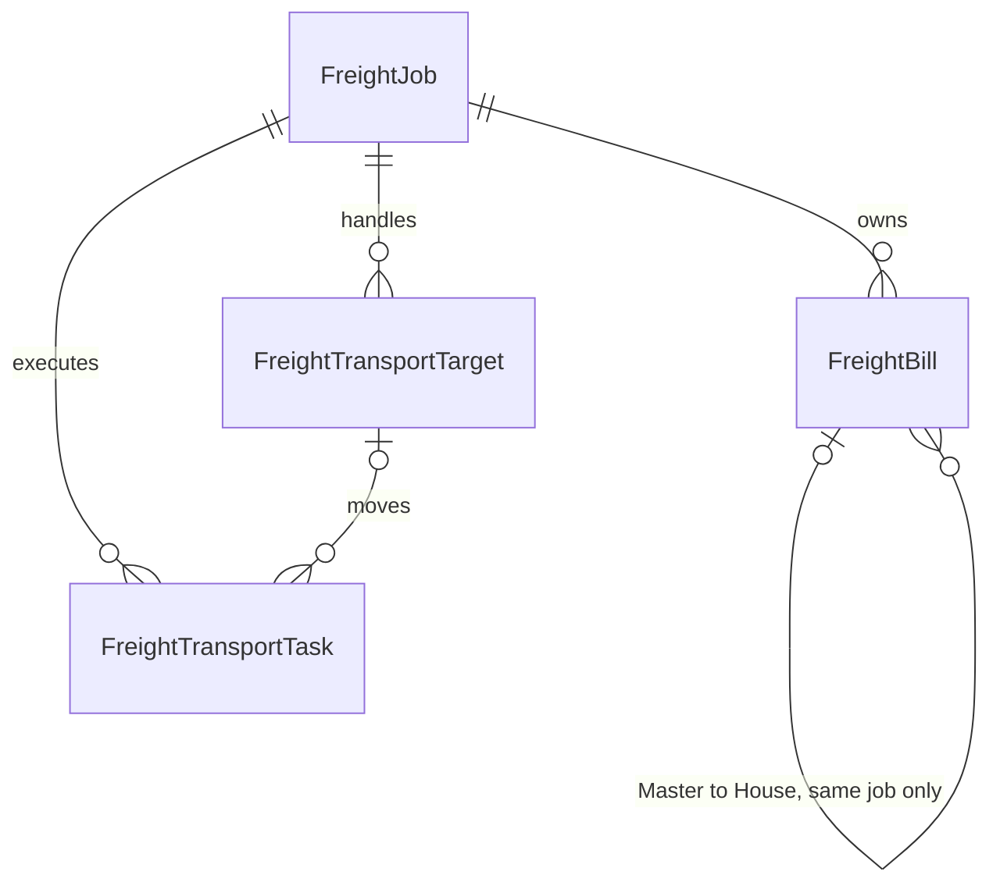

# 운송건 중심 물류 관리

운송건은 고객의 한 업무 의뢰를 진행하는 독립 단위다. BL·컨테이너·배차·청구서와 동일한 단위로 취급하지 않는다.

- `FreightJob`의 기존 ID·자동 관리 번호·감사·문서 연결을 유지한다. 신규 화면의 생성 필수 정보는 고객뿐이다. 담당자·업무 유형·운송 방식·출발지·도착지·예정일·상태·메모는 등록 후 보완할 수 있다. 기존 인도 완료 상태의 인도일/수령인 검증은 유지한다.
- `FreightBill`은 실제 수령한 Master 또는 House다. 번호가 없는 임시 BL을 생성하지 않는다. House의 `masterId`는 단일 선택이며 NULL을 허용한다. 복합 FK와 DB 트리거가 같은 회사·같은 운송건·MASTER 유형·미삭제 상태를 검사한다. 연결 변경/해제는 House와 운송건 소속을 유지한다.
- BL 번호에는 전역 또는 회사별 유일 제약이 없다. 유형·발행 주체도 별도 필드다. 화면은 같은 운송건의 동일 유형/번호/발행 주체에 주의를 표시하지만 자동 병합하지 않는다.
- BL 수정·삭제는 운송건 잠금과 revision 검사를 사용한다. 삭제는 감사 이력을 남기는 논리 삭제다. 활성 House가 연결된 Master는 삭제를 차단하며, House를 해제하거나 다른 Master로 옮긴 후 삭제한다. 물리 삭제와 삭제된 BL의 수정/복구는 차단한다.
- `FreightTransportTarget`은 CONTAINER/CARGO다. 컨테이너 번호를 전역 고유 키로 쓰지 않는다. `FreightTransportTask`는 PICKUP/DELIVERY/EMPTY_RETURN/OTHER 작업이며 동일 대상에 여러 작업을 연결할 수 있다. 작업에는 파트너·차량·기사·예정 시각·상태를 담을 수 있다. 이 두 테이블의 입력/배차 API와 화면은 이번 범위에 포함하지 않는다.

## 기존 자료와 접근 범위

`20261105140000_job_bills`는 새 불변 migration이다. 기존 운송건의 실제 Master/House만 새 BL 구조로 옮겨 담으며 기존 운송건·Master·포장물·출고·문서 snapshot·감사를 수정하지 않는다. 예전 Master가 여러 운송건에 쓰였다면 각 운송건의 독립 BL 기록으로 만든다. 미확정/번호 없음은 BL 행을 생성하지 않는다. 이전 Master/출고 화면은 기존 자료 열람과 문서 기능을 위해 보존한다.

새 `/freight/transport-jobs` API는 기존 FREIGHT 역할·업종 메뉴 제한을 그대로 통과한다. 실제 회사의 ACTIVE ADMIN/OPERATOR/ACCOUNTANT만 접근하며 SYSTEM 단독 우회를 허용하지 않는다. 고객과 담당자는 현재 회사 범위에서 확인한다. 다른 회사의 운송건·BL은 조회/수정/연결할 수 없다.

## 회계 연계 경계

기존 비용은 `ExpenseRequest`와 `PartnerTransactionCost`, 실제 자금은 `BankLedgerEntry`/`BankLedgerEvidenceAllocation`, 청구는 `Invoice`/`InvoiceLine`에서 관리된다. 이번 운송건/BL 저장은 이 금융 기록을 생성하지 않는다.

후속 구현은 기존 비용 항목/청구 행을 운송건 ID에 연결하는 회사 범위 참조·배분을 추가해야 한다. 매출·매입의 기본 귀속은 운송건이며, 필요할 때 대상/작업 ID를 세분화한다. 한 청구서에 여러 운송건, 한 운송건에 여러 청구/부분 청구를 허용하며 운송건에 단일 invoiceId를 고정하지 않는다. 이미 비용 신청한 금액을 물류 비용으로 다시 생성하거나, 운송건 연결을 실제 입출금으로 간주하지 않는다. 기존 제조 주문 전용 `ExpenseItemReference`에 가짜 제조 주문을 생성하지 않는다.

## 검증

`scripts/freight-jobs.test.mjs`는 BL 없는 생성, House/Master 단독과 복수, 지연 연결, 변경/해제, 다중 Master 입력·다른 운송건/회사 연결 차단, 수정 충돌, Master 삭제 보호, SQL 제약, 번호 재사용과 원자료 보존을 검사한다. 새 화면은 `freight-jobs-browser.test.mjs`에서 한/영/베 등록·연결·해제·수정을 확인하고 기존 물류 검사도 유지한다. 배차·고객 청구·파트너 정산·손익 계산은 미구현이다.
